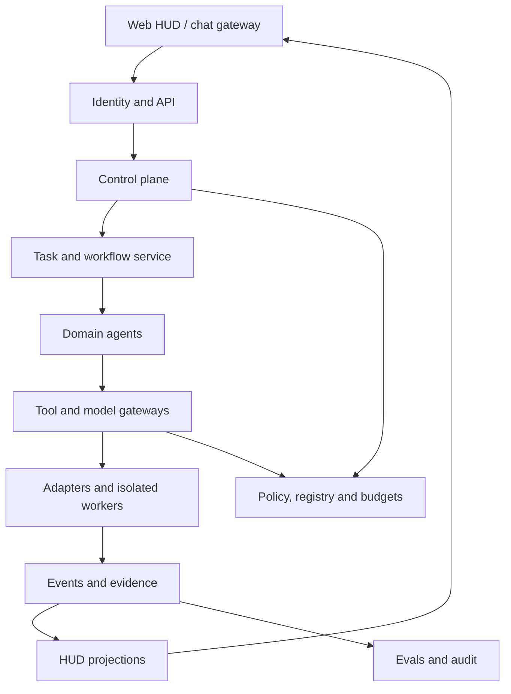

# Enterprise Agent Platform with Agent Operations HUD
## Integrated Blueprint 1.1
Date 05/11/2026, revision 1.1 on 06/11/2026 following `docs/ARCHITECTURE_REVIEW.md` (ADR-011–ADR-016). The repository currently contains specification, contracts, fixtures and validators; application code is not yet implemented. Scope encompasses an enterprise with multiple departments, projects and agents. A single-workspace pilot can operate locally or on a private server. Company/tenant_id serves as the data boundary from the start.

## 1. Objectives and outcomes
The platform registers agents, assigns tasks, executes workflows, enforces permissions, captures evidence and provides the HUD for monitoring and intervention. PPM v2 is the first domain, managing inventory by location path and synchronizing `.ppm/`. Other domains participate via the identical integration contract.

Expected outcomes include agent inventory with owner/version, task/run history, source-attributed PPM progress, exact action approvals, cost tracking by task tree and agent releases backed by evaluation evidence. Phase 2 improves harnesses based on traces and experiments.

### Phases
| Phase | Outcome |
|---|---|
| Phase 1 | Platform core, HUD, PPM v2, onboarding kit, one real adapter and operational pilot |
| Phase 2 | Harness Optimization Agent, context/retrieval/model-routing experiments, canary/rollback, domain expansion by priority |

Phase 1 must include (unimplemented) authentication, authorization, durable run journal, idempotency, sandbox profile, budgets, audit and eval baseline. Phase 2 optimizes quality and performance on the measured foundation.

## 2. Architecture

The control plane owns registry, version/deployment, policy, task admission and budgets. The execution plane owns workflow nodes, adapter dispatch, worker leases and cancellation. The data plane contains domain DB, evidence blobs, document corpus and rebuildable search indexes. The assurance plane contains traces, audit, evals, incidents and release gates.

### Service responsibilities
| Module | Responsibility | Business owner |
|---|---|---|
| Agent Registry | Agent definition, release, capability certification | Platform team + business owner |
| Task Service | Objective, input/output refs, dependencies, task tree | Domain requesting task |
| Run Service | Attempts, dispatch, provider session, checkpoint | Platform |
| Domain Services | Project, risk, document, editorial business rules | Domain owner |
| Policy/Action Service | Tool permissions, exact action approvals, execution journal | Security + platform |
| Model Gateway | Provider/model profile, egress, quota, usage | Platform/data owner |
| Evidence Service | Immutable artifacts, revision/hash, lineage/access | Producer + data owner |
| HUD Projection | User-scoped views, attention queue, run detail | Operations |
| Harness Optimization | Candidate proposals, experiments, release evidence | Phase 2 engineering owner |

## 3. Deployment topology
The local pilot consists of API/worker/PostgreSQL, evidence directory and web HUD. The Windows host runs local connector, workspace manager and dedicated Ollama. Server deployment uses Ubuntu/Docker/Traefik, OIDC and HTTPS. The connector opens an authenticated outbound connection to the server, receiving jobs scoped by host and registered roots. Domain objects use logical location_id; the connector resolves host paths. In the local MVP, the connector is a module running in the worker process on the same machine, using the same contract `location-registration` 1.1; separation into an outbound service occurs upon transition to private server. No standalone services are introduced for Evidence/HUD Projection/Policy in the pilot: these are modules of a modular monolith with internal API boundaries.

Single-tenant pilot with OIDC or loopback bootstrap identity for personal development. Enabling multi-user or network exposure requires OIDC and resource authorization prior to rollout. Secrets remain in credential stores and deployment configs; API responses return only credential references.

SQLite can serve as local spool for the connector when offline. PostgreSQL is authoritative platform state. Connector replays spool via dedup keys. Shared filesystem writes are constrained by workspace isolation and process ownership. A single writer/integration worker per target branch.

Machine hardware discussed previously represents pilot assumptions requiring benchmarking before capacity commitments. Ollama concurrency starts at 1 on local GPU; GPU render/OCR and interactive inference utilize dedicated queue quotas. Provider and model IDs are deployment configs probed prior to use.

## 4. Stack and orchestration owner
Backend Python/FastAPI/Pydantic; PostgreSQL/SQLAlchemy/Alembic; React/TypeScript for HUD. Run Service (PostgreSQL) is the sole owner of task/run/attempt state, dispatch journal, lease/fencing and cancellation (ADR-011). LangGraph is utilized strictly inside a run attempt of a native domain agent to coordinate reasoning steps; LangGraph checkpoints keyed by run_id+attempt constitute internal rebuildable data, not the state authority for HUD or retries. Because LangGraph replays nodes from the beginning, graph nodes never invoke external side effects directly; all side effects pass through Action Service/tool gateway with operation_key and execution journal. The domain reducer owns business mutations. The pilot work queue is a PostgreSQL table with `FOR UPDATE SKIP LOCKED` lease, avoiding message brokers until measurements warrant.

Provider SDKs are invoked through Model Gateway. Claude Agent SDK, Codex, OpenCode and external HTTP/CLI agents route through adapter boundaries. Runtimes with native agent loops run as child executions with correlation IDs and resource caps. Pydantic AI/Deep Agents serve as candidate runtimes in Phase 2 or certified standalone adapters. Temporal is introduced only via an ADR migration specifying workflow ownership transfer and in-flight run handling.

PostgreSQL full text and metadata satisfy the pilot PPM. Knowledge may incorporate pgvector or Qdrant following retrieval benchmarks. S3-compatible object storage is introduced when worker distribution or retention/backup requires; content-addressed filesystem suffices for local pilot. OpenTelemetry/OTLP handles traces; evidence and audit maintain independent lifecycles.

## 5. Agent, task, run and acceptance
AgentDefinition defines proposed capabilities. AgentRelease is an immutable configuration with a bundle digest. DeploymentBinding associates release with runtime, endpoint, secrets, scope and certified capabilities. AgentInstance/Worker is an active process. Task is a business requirement. Run is an attempt. ProviderSession is vendor-side identity.

Task states include draft, ready, active, blocked, review_required, completed, failed, cancelled. Run states include queued, dispatching, running, waiting_approval, cancelling, succeeded, failed, cancelled, timed_out, unknown. Connectivity tracks healthy/stale/offline independently. Remote outcome (known/unknown) is an independent axis: run `unknown` indicates the platform cannot determine if the provider received or executed the task; HUD must not display it as failed or retryable. Cancellation on an unknown run is recorded as intent and executed only after reconciliation (docs/02). PPM verification and acceptance remain separate domain axes.

Run succeeded merely supplies results for domain verifier evaluation. A scan task may complete when snapshot intake is valid, while the project remains unaccepted. Task completion follows task-type completion policy. Retry generates a new run with attempt +1, preserving history. Resume checkpoint retains run identity when continuation is valid and supported by the adapter.

## 6. Domains and relationships
PPM owns project/program/portfolio, acceptance criteria, dependencies, benefits and status assessment. Knowledge owns document versions, source ACLs, effective dates and citations. Governance/Risk owns requirements/control mappings and review workflows. Research owns source registry, event clustering and briefings. Productivity owns reminders/subscriptions; referencing project IDs from PPM. Editorial and Media own draft/revision/publish/render lifecycles. Engineering/Operations are execution domains with scoped authority.

Secretary serves as interface and routing layer across web/chat, utilizing shared Task Service and Action Service. Chat identity maps via credentials or verified bindings. Domain agents exchange typed task/result refs. Synthesis agents access only authorized resource scopes.

## 7. Data and trust boundaries
All APIs enforce tenant boundaries from authenticated contexts. Retrieval filters permissions pre-search and re-checks during reading and citing. Domain DB is authoritative for objectives/baselines/approvals. Evidence records artifact ID, hash, revision, producer and classification. Run memory holds checkpoint and context summaries, with each summary tagged with derived_from and freshness.

Cloud Policy C authorizes egress based on permissions, purpose, classification and provider approval. Enforces checks across embeddings, telemetry and fallback providers. Binding 1.1 enumerates `fallback_model_profile_refs`, `embedding_profile_ref`, `egress_policy_ref` and `telemetry_export`; Model Gateway denies by default any profile omitted from binding, even during primary provider outages. OTLP/trace export defaults to `local_only`. Model Gateway rejects requests lacking policy or authorized profile. Tool outputs, repo docs, `.ppm` notes/updates, MCP and websites represent untrusted data: they can formulate claims, but cannot alter verified/accepted states, grant permissions or trigger tools. Tool execution enforces server-side controls. Producer event `tenant_id` is matched by ingestion against authenticated binding; mismatches trigger quarantine. Vendor runtimes executing tools server-side (e.g. built-in toolsets in Claude Managed Agents) operate outside Action Service and must declare `execution_boundary=external_trusted` unless disabled (docs/06).

## 8. HUD
The primary HUD encompasses attention queue, tasks/runs table, agent health and capacity, project overview, trace inspector, approvals, artifacts and version/eval views. All states display as_of, source, coverage and connectivity. UI submits commands to API; server validates capability/permission/current revision prior to execution.

Progress displays x/y or percentage only when the denominator is substantiated. Research tasks show current stage and elapsed time. Cost presents actual/estimated/partial/unknown markers (partial serves as lower bound when calls with unknown costs exist; totals never treat unknown as 0), provider_usage_as_of and scope to prevent cumulative double counting. Cost ceiling relies on reservation + reconciliation, with potential unbilled usage requiring concurrency and token limits during dispatch.

## 9. Phase 2 harness initiative
Harness Optimization Agent inspects authorized traces, classifies failures, generates hypotheses, proposes candidate patches/configs, executes offline controlled experiments and submits release recommendations. Experiment Service and human reviewers govern test sets, secrets/holdouts and promotions. Each candidate pins model profile/prompt/tools/retrieval policy and source revision.

Harness package includes context builder, tool contracts, planning/termination rules, retry/recovery, memory/compaction, verification and telemetry. Candidates are evaluated across quality, completion, grounding, tool correctness, cost, latency, retries and security regression. Canaries define rollback triggers prior to rollout.

## 10. Roles and responsibilities
Business owner defines outcomes and acceptance. Platform owner operates registry and runtime. Data owner authorizes data scopes. Security owner confirms policy profiles. Reviewer executes acceptance. Operator intervenes on tasks within granted authority. In personal pilots one individual may assume multiple roles, while audit continues recording actors and decisions explicitly.

Agent package self-declares desired permissions. Trusted deployment binding grants effective capabilities. Human approvals bind action digest, target revision, expiry and approver scope. Services re-verify upon execution and consume approvals once within transactions. Credential revocation terminates new dispatches and tool calls while triggering cancellation and reconciliation with active remote executions.

## 11. Roadmap and delivery
Phase 1 comprises P0 contract/discovery, P1 control plane, P2 PPM intake, P3 HUD, P4 PPM program/portfolio + adapter pilot, P5 hardening/acceptance. Local MVP is the vertical slice P0+P1a+P2a+P3a concluding with D1-fixture (register once, scheduler auto-scans after project modifications → HUD reveals: which criteria advanced, which evidence belongs to current revision, why agent "done" claim is insufficient for acceptance) followed by Local-pilot (real directory + real Ollama); shared pilot requires P1b, P3b, P4, P5. Work packages, dependencies and acceptance evidence reside in `docs/IMPLEMENTATION_PLAN.md`. Phase 2 comprises H0 baseline, H1 context/tool experiments, H2 Harness Optimization Agent, H3 canary/rollbacks.

Detailed API/state transitions, HUD behavior, templates, onboarding, eval/operations and reconciliation decisions reside in accompanying documents. Gates are accepted via runtime evidence during implementation; the current package verifies structure, examples and architectural consistency.
