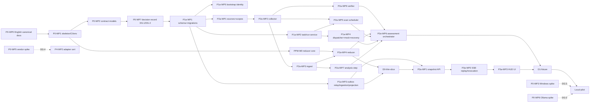

# Implementation Plan — Enterprise Agent Platform 1.1 (plan revision 1.5)

Date 06/11/2026. Sources: `MASTER_BLUEPRINT.md` 1.1, `docs/ARCHITECTURE_REVIEW.md`, `docs/01` (ADR-011…026), `docs/DEV_ENVIRONMENT.md`, contracts 1.1. Milestone IDs preserved per `docs/07` (P0–P5, H0–H3); suffixes `a`/`b` decouple local MVP from shared pilot.

## 0. Changes from plan 1.1 (owner feedback, round 3)
| Feedback | Change in plan 1.2 |
|---|---|
| Auto-scan registered locations | New WP **P2a-WP5 Scan Scheduler** owns scan schedules; D1 registers once, second scan triggers automatically; rerun deduplicates (C35) |
| Decouple fixture demo from local pilot | Two milestones **D1-fixture** (temp directory, mock, fake model) and **Local-pilot** (real directory, real Ollama). P0 exit no longer mandates Ollama/Windows spikes; each spike attaches to its respective gate (§3) |
| Idempotency across attempts | DG-1 finalized prior to first migration: key issuers, unique scopes, detecting identical key with divergent payload; `task_intents`, `action_executions` (unique tenant+operation_key, storing payload_hash) decoupled from `dispatch_intents` (per run); C29, C38 |
| Contradictory evidence on identical criterion | Fixture updated: **AC-001** includes "done" note + PASS rev-r1 + FAIL collected at rev-r2. P2a-WP4 explains source, revision, baseline, test scope; P2b-WP2 rejects acceptance because AC-001 is required |
| Monorepo and shared components | Decouple physical `source` from project scope (`source_id`, ADR-022); P2a-WP1/WP6 verify two projects sharing repo + component; editing note of A leaves B assessment unchanged (C32) |
| HUD replay and permission revocation | Offsets issued by outbox relay in commit order (ADR-020), testing commit 11 before 10 (C33); permission revocation during active SSE + finalized evidence policy: no signed URLs (C30) |
| Benchmark and capacity | Decouple **baseline measurements** (P1a-WP7, P2a-WP8, P3a-WP4, Local-pilot) from **acceptance against approved thresholds** (DG-5 → P5-WP4); mandatory measurement list (SC-07) |
| Finding traceability, Phase 2 rigor | §9 includes all ARCH-01…33 with `design_status` and `runtime_evidence`; H0-WP2 validates runner with fixed output, measures baseline variance, permits `inconclusive` |
| P5 circular Phase 2 dependency | §5 maps cases → milestones; P5-WP2 enumerates exact cases; C26 assigned to H1; SC-03 requires due cases only; prerequisite P5-WP3 lists specific WPs |
| D1 orchestration ownership | New WP **P2a-WP6 Assessment Orchestrator**: snapshot→assessment, model failure, current assessment pointer via `snapshot_seq` (C34, C36) |
| Template onboarding | New WP **P4-WP3**: second party follows guide for new agent and existing agent, verifies grants, executes tasks, views HUD, revokes binding; records evidence level per capability (C37) |
| §3 diagram defect | Snapshot assigned to P3a-WP1, SSE to P3a-WP2; dependencies and effort recalculated (§4, §10) |

### Round 4 (plan 1.3)
| Item | Modification |
|---|---|
| Unified P0 handoff state | Coder hands off `P0 ready_for_owner_review`; owner signs DG-1/DG-2 → `P0 closed`; P1a migration begins strictly afterwards (§3, §6 P0, §11, prompt) |
| `action_slot` | Workflow/Action Service issues or validates, stored in `task_intents` before initial tool call, recovered on retry; C29b: agent proposing new slot after restart still produces 1 PR |
| Reassessment on same snapshot | DG-2 triggers independent of file scanning and CAS via `basis_seq` (contract `ppm-output` adds `basis_seq`, `trigger`); C39 baseline change during in-flight older assessment |
| Dependencies and effort | P2a-WP7 on critical path to D1 (WP7 → WP6); single engineer order fully sequenced; §10 decouples Scenario A (no spikes) 36.5–53.5 from B (all four spikes) 40–59.5 |

### From PPM v2 review (plan 1.4)
| Item | Modification |
|---|---|
| In-repo reports not independent evidence (PPM-01) | New WP **P2a-WP9 Verifier**: reruns mapped tests/probes at exact revision in sandbox; only `verifier_observed`/`ci_attested` verify (ADR-023); C40 |
| Waivers, draft baselines, repo copies, hidden portfolio projects | C41 (P2b-WP2), C44 (P2a-WP4/WP6), C42 (P2a-WP1), C43 (P4-WP1) |
| Effort | P2a 16.5–24; to D1-fixture: Scenario A 38.5–56.5, B 42–62.5 |
| PPM domain details | `ppm-v2/docs/IMPLEMENTATION_PLAN.md` (PPM-M0 runs parallel to P0/P1a; PPM-WP items attach to platform WPs) |

### Round 5 (plan 1.5) — implementation preparation
| Item | Modification |
|---|---|
| Repository language | New WP **P0-WP0**: English canonical (agent reads/edits); Vietnamese stored in `docs/vi/<original path>` for review only, agent does not read (ADR-025, §12) |
| Environment | Python 3.12, PostgreSQL `18.6-trixie`, Node 26 LTS; Redis `8.10.1-trixie` and Qdrant `v1.20.0` in compose profile `optional`, off critical path to D1 (`docs/DEV_ENVIRONMENT.md`) |
| Early feedback | New milestone **D0-thin-slice** after P2a-WP4: fixture → collector → reducer (PPM-M0) → DB assessment → static HUD page with Reported/Verified columns + diff (§6) |
| Two-track sequencing | PPM-M0 runs during owner review of DG-1/DG-2; P2a-WP4 embeds `ppm_reducer` instead of rewriting (reduces to 1.5–2 days); P1a-WP4…WP7 runs parallel to PPM track post-D0 (§4) |
| Workflow | `AGENTS.md`, `STATUS.md`, `docs/ISSUES.md`, `docs/REVIEW_LOG.md`, `prompts/REVIEW_SESSION.md`: agent executes one WP per session on `wp/<ID>`, updates STATUS/ISSUES; review sessions inspect repo independently without relying on chat history (§12) |

## 1. Phases and milestones
| Milestone | Milestones | Observable outcome |
|---|---|---|
| **D0-thin-slice** | P0, PPM-M0, P1a-WP1…WP3, P2a-WP1…WP4 | Single fixture project scanned twice; assessments A1/A2 stored in DB; static HUD page shows Reported/Verified columns and diff. No scheduler, verifier sandbox, SSE, or dispatch. Purpose: owner confirms presentation adequacy prior to P3a investment |
| **D1-fixture** | P0 → P1a → P2a → P3a | Register fixture project once; scheduler auto-scans after project modifications; HUD answers: which criteria advanced, which evidence belongs to current revision, why agent "done" claim is insufficient for acceptance. Mock provider: lost ACK/restart/cancel/retry → exactly 1 action |
| **Local-pilot** | D1-fixture + DG-3 | Same three questions on real project (read real directory, read-only), analysis step using real Ollama; baseline metrics on live data |
| **Shared pilot** | P1b, P2b, P3b, P4, P5 | OIDC/RBAC, approvals, 5 representative projects, certified real adapter, second-party onboarding, restore drill, acceptance against approved thresholds |
| **Phase 2** | H0 → H1 → H2 → H3 | Verified evaluator, baseline variance, paired experiments, bounded optimizer, canary/rollback |

## 2. Estimation assumptions
Single engineer + coding agent, 6 effective hours/day, Windows dev, Python 3.12, Node 26 LTS, PostgreSQL 18.6 (Docker, `docs/DEV_ENVIRONMENT.md`), local Ollama for Local-pilot. Redis/Qdrant omitted from effort prior to D1. Effort = person-days [low–high]; high includes post-review revisions. Decision wait time excluded. Parallel tracks shorten calendar time only with a second engineer; with one engineer, calendar ≈ total effort.

## 3. Decision gates
| Gate | Timing | Owner signature required | Evidence |
|---|---|---|---|
| **DG-1** | Closing P0 (owner signs after coder hands off `P0 ready_for_owner_review`); required before P1a-WP1 migration | (a) Action key ADR-017 rev. 2: Task Service issues `task_intent_key`=sha256(tenant\|task_id); Action Service issues `operation_key`=sha256(tenant\|task_id\|action_slot). `action_slot` is business step label (e.g. `create_pr#1`), **excludes** target, **issued or validated by workflow/Action Service** per step list, **persisted in `task_intents` prior to initial tool call** and recovered on retry/resume; agent-proposed slots after restart do not spawn new keys (C29b). Unique (tenant, operation_key); persists `payload_hash`=sha256(tool_id\|arguments_sha256\|resource_ref); differing hash → 409 `OPERATION_KEY_CONFLICT`; dispatch key per run. (b) HUD cursor ADR-020: relay-issued offsets post-commit. (c) Source/scope ADR-022. | P0-WP7 decision record + draft DDL |
| **DG-2** | Closing P0 (concurrent with DG-1) | Scheduler policy (interval, debounce, catch-up); **reassessment triggers independent of file scanning** (`snapshot`, `baseline_changed`, `evidence_ttl_expired`, `model_recovered`, `manual`) and current assessment rule ADR-021 rev. 2: CAS via `basis_seq` issued at assessment task creation, inputs (snapshot, baseline, policy/TTL) locked at creation, ensuring order even on identical `snapshot_seq` (C39); D1-fixture scenario | P0-WP7 + D1 scope |
| **DG-3** | Prior to Local-pilot | P0-WP3 passed (real Windows directory read permissions); P0-WP6 passed (real Ollama with selected model); D-06 egress = local-only | Spike reports |
| **DG-4** | Prior to adapter certification (P4-WP2) | P0-WP5 for target adapter; D-02 | Capability matrix |
| **DG-5** | Prior to P5-WP4 | Performance and storage acceptance thresholds based on baseline measurements; D-05 retention | Baseline reports |
| (resume) | Prior to enabling resume for side-effect workflows | P0-WP4 passed on pinned LangGraph version (if using LangGraph, D-01) | Spike report |

## 4. Dependencies and critical path

Critical path to D1-fixture: P0-WP0 → P0-WP1 → WP2 → WP7 → (owner signs DG-1/DG-2) → P1a-WP1 → P2a-WP1 → WP2 → WP3 → WP4 → WP6 → D1 (~17.5–25.5 days on this track; PPM-M0 must complete before P2a-WP4), provided P1a-WP2/WP4, P2a-WP5, P2a-WP7, P2a-WP9 and P3a complete prior to WP6/D1. P2a-WP7 lies on the critical path to D1 because the orchestrator invokes the analysis step even with fake models in fixtures. Single engineer sequence (rev 1.5): P0-WP0 → P0-WP1, WP2, WP7 (`P0 ready_for_owner_review`) → **PPM-M0 during owner DG-1/DG-2 review** → P1a-WP1 → WP2 → WP3 → P2a-WP1 → WP2 → WP3 → WP4 (embeds `ppm_reducer`) → **D0-thin-slice** (owner review) → P2a-WP9 → WP5 → WP7 → WP6 → WP8 → P1a-WP4 → WP5 → WP6 → WP7 → P3a-WP1…WP4 → D1; spikes P0-WP3–WP6 execute during review intervals (see §10 scenarios). Two engineers: engineer B handles P2a-WP1→WP4 and P3a-WP3 (with fixtures) parallel to P1a.

## 5. Shared checks and conformance matrix
- **SC-01** `python tools/validate_package.py` pass; code models verified against `contracts/*.schema.json`.
- **SC-02** `pytest -q` pass; skips require documented rationale in tests.
- **SC-03** Conformance harness: `test_Cxx_*` for **cases due at active milestone** per table below; output `artifacts/conformance/<milestone>/<case>.json` with observed_outcome, counts, evidence refs. Cases not yet due record `not_due`, not `not_run`.
- **SC-04** Secret canary `EAP-CANARY-<uuid>` must not appear in logs/events/traces/artifacts.
- **SC-05** Evidence packet conforming to `templates/ACCEPTANCE.md`.
- **SC-06** Migration up/down/up on empty and fixture databases.
- **SC-08** `python tools/check_translation.py`: all `docs/vi/**` possess header `Translated from <path> @ <sha>`; warns on stale translations (original modified post-sha). Stale translations serve as warnings, not merge blockers.
- **SC-07** Measurement report: environment, data (file count, total bytes), iteration count, p50/p95, DB+WAL growth, backup size, comparison to prior baseline. Baselines record numbers; acceptance evaluates against DG-5 thresholds.

| Milestone | Due cases (SC-03) |
|---|---|
| P1a | C01, C02, C05, C06, C07, C13, C14, C15, C19, C21, C23, C29 + C29b (dispatch + mock tool), C33, C38 |
| P2a | C08, C11, C16, C17, C22, C24, C31, C32, C34, C35, C36, C39, C40, C42, C44; C27 on Linux/temp root |
| P3a | C09, C10, C11 (HUD), C28, C30 (bootstrap principals) |
| D1-fixture | Re-run C21, C29, C31, C34, C35 end-to-end via HUD |
| Local-pilot | C27 on native Windows, C22 and C36 with real Ollama |
| P1b | C03, C04, C12, C29 + C29b (real Action Service) |
| P2b | C24, C32 across 5 projects; reject acceptance (C31 + P2b-WP2); C41 |
| P3b | C30 with OIDC |
| P4 | C25, C37, C43; C01/C05/C06/C13/C21 on real adapter |
| P5 | C20 (P5-WP1); C10, C12, C14, C15, C22, C23, C25, C27, C28, C30, C33 on server (P5-WP2) |
| H1 | C26 |
| H2 | C18 |

## 6. Local MVP → D1-fixture

### P0 — Foundations, contracts in code, decision record (exit 5–7.5 days including WP0; spikes add 3.5–6 days parallel)
**P0-WP0 English canonical docs** — 1.5–2.5 days [new, rev 1.5, ADR-025]
- Objective: English becomes canonical so agents consume fewer tokens; Vietnamese preserved for owner review.
- Scope: `README.md`, `MASTER_BLUEPRINT.md`, `docs/*.md`, `guides/`, `evals/*.md`, `templates/**/*.md`, `prompts/*.md`, `ppm-v2/**/*.md` (blueprint, standards, guides, docs, prompts, evals). Omit `contracts/`, `examples/`, schemas, YAML/JSON (already English).
- Steps: (1) for each file: `git mv` Vietnamese file to `docs/vi/<original path>` and prepend header `Translated from <path> @ <sha>` (reverse lineage: vi preserves original sha); (2) write English canonical at original path, preserving heading anchors, tables, IDs, numbers, commands, paths; (3) `tools/check_translation.py` compares identifier sets (ARCH-xx, PPM-xx, Cxx, WP IDs, ADR-xxx, DG-x, D-xx, reason codes, backtick paths, numbers with units) between vi and en, and SC-08 mode reports stale vi copies; (4) update `AGENTS.md`: do not read `docs/vi/`.
- Failure tests: script detects missing ID and modified number (deliberate broken fixture); internal links validated.
- Acceptance: `python tools/check_translation.py --compare` → 0 identifier differences across all files; SC-01; internal link check 0 errors; owner samples 3 files (review, plan, docs/04) and signs off. Evidence: script output, file list. Rollback: `git revert` translation commit; vi preserved.
- Post-WP0: new documentation authored in English; owner requests vi translations on demand (SC-08 reports staleness).

**P0-WP1 Skeleton, CI and environment** — 1–1.5 days
- Objective: functional modular monolith, zero business logic, per `docs/DEV_ENVIRONMENT.md`. Paths: `pyproject.toml` (uv workspace: `eap` + `ppm-v2/reducer`), `uv.lock`, `compose.yaml`, `.env.example`, `src/eap/{api,run,task,events,policy,action,evidence,hud,model_gateway,adapters,ppm}/`, `tests/`, `web/hud/`, `scripts/ci.ps1`.
- Steps: FastAPI `/healthz`; pytest/ruff/mypy; Vite+React+TS shell on Node 26; compose PostgreSQL 18.6 default, Redis/Qdrant `optional` profile; config `pydantic-settings`; `AGENTS.md` updated with real build/test commands; CI executes SC-01, SC-08 and `sha256sum -c SHA256SUMS.txt`.
- Acceptance: checklist §"P0-WP1 Checklist" in `docs/DEV_ENVIRONMENT.md` satisfied, SC-01, `pytest -q` ≥1 test, `npm --prefix web/hud run build`; app starts when `REDIS_URL`, `QDRANT_URL` empty. Evidence: CI logs, lock files, image digests. Rollback: purge skeleton.

**P0-WP2 Contract models** — 1.5–2 days
- Objective: Pydantic models for 16 schemas + `eap.contracts.rules` (porting semantic checks: transitions, assessment, HUD, approval pairing, operation-key reuse, source/scope set, `apply_assessment`, RFC 8785 digest).
- Failure tests: all negatives in `validate_package.py` rejected by models/rules.
- Acceptance: SC-01, SC-02; digest template = `76580e7cecb951cc2e84d499b6006492bd394b4b44c068372464aedf2d30a436`. Rollback: models decoupled from runtime.

**P0-WP7 Decision record DG-1/DG-2** — 1–1.5 days
- Objective: documented decisions prior to migration: tables and constraints for `task_intents`, `action_executions`, `dispatch_intents`, `outbox`, `event_log` (offsets by relay), `sources`, `project_scopes`, `ppm_scan_schedules`, `project_current_assessment`; sequence diagrams C29/C33/C34; scheduler policies.
- Paths: `docs/adr/DG-1.md`, `docs/adr/DG-2.md`, `migrations/draft/0001_core.sql` (draft, unexecuted).
- Mandatory content: slot issuance/persistence/recovery for C29b; reassessment triggers, `basis_seq` and C39 sequence diagram.
- Coder acceptance: documentation + draft DDL complete, status `P0 ready_for_owner_review`. Owner signs DG-1, DG-2 in `docs/01` → `P0 closed`. Rollback: documentation.

**P0-WP3 Spike Windows path containment** — 1–2 days [DG-3]
- Variants: symlinks, junctions, hardlinks, ADS, 8.3, UNC/`\\?\`, case sensitivity; `safe_open(root, rel)` via handle + final path + link count. Acceptance: pass/fail matrix Windows + Linux; choose pywin32/ctypes.

**P0-WP4 Spike LangGraph replay (pinned version)** — 1 day [gate resume, D-01]
- In-node crash, observe replay, durability modes, checkpoint keyed run_id+attempt; fake model. Acceptance: report + recommendation.

**P0-WP5 Spike vendor lookup/cancel** — 1–2 days [DG-4]
- `docs/adapters/CAPABILITY_MATRIX.md`: submit, status, lookup by key, events, cancel, resume, usage, server-side tools; each cell cites source+date or `unknown`.

**P0-WP6 Spike Ollama** — 0.5–1 day [DG-3]
- Benchmark tokens/s, p95 at concurrency 1/2 on pilot GPU with planned model; default NUM_PARALLEL/MAX_QUEUE of installation.

P0 has two states: **`P0 ready_for_owner_review`** when coders complete WP1, WP2, WP7 (session end for coder); **`P0 closed`** when owner signs DG-1 and DG-2. Only post-`P0 closed` does migration P1a-WP1 execute. WP3–WP6 do not belong to either state.

### P1a — Core task/run, events, mock adapter, recovery (11–16 days)
**P1a-WP1 Schema and migrations** — 2–2.5 days
- Paths: `migrations/versions/0001_core.py`, `src/eap/db/`. Per DG-1: `tasks(task_intent_key unique)`, `runs`, `run_attempt_history`, `dispatch_intents(unique binding_id, run_id, operation)`, `task_intents`, `action_executions(unique tenant_id, operation_key; payload_hash; state; external_ref)`, `leases(fencing_token)`, `commands`, `outbox(no offset)`, `event_log(ingest_offset assigned by relay)`, `artifacts`, `usage_ledger(unique provider_usage_id)`, `sources`, `project_scopes(unique source_id, metadata_root)`.
- Failure tests: C02; insert action_execution matching key differing payload_hash → 409; SC-06.
- Acceptance: SC-06; constraint tests. Rollback: `alembic downgrade base` on empty DB.

**P1a-WP2 Task/Run service** — 2–3 days
- `POST /v1/tasks` (202, idempotent tenant+client key), `GET /v1/tasks/{id}[/runs]`, `RunService.transition(...)`; atomic run + history + outbox transaction; issues `task_intent_key`; `retry_new_attempt` → 409 `REMOTE_OUTCOME_UNKNOWN` when run unknown.
- Failure tests: C01, C19, illegal transition 409, late terminal events. Acceptance: property tests random sequence always legal.

**P1a-WP3 Outbox relay, ingestion, projection** — 2–3 days
- Single relay (advisory lock per tenant stream) assigns offsets post-commit (ADR-020); producer auth; tenant from binding; deduplication; gap detection; versioned projection reducer.
- Failure tests: **C33** (forced commit 11 before 10 via dual connections and barrier), C02, C23, out-of-order.
- Acceptance: replay from any cursor = projection rebuild = fresh snapshot (hash match); 0 lost/duplicate events. Rollback: relay feature flag, outbox intact.

**P1a-WP4 Dispatcher, mock provider, recovery, cancel** — 3–4.5 days [ARCH-03/04/20]
- Paths: `src/eap/run/dispatcher.py`, `src/eap/action/executor.py`, `src/eap/adapters/mock_provider.py` (drop_ack, crash_after_send, slow_cancel, lookup_supported, create_pr accepting client token).
- Steps: lease + fencing; journal prepared→sent→acknowledged/ambiguous; reconcile via lookup; cancel semantics; action executor checks `action_executions` before calling tools.
- Failure tests and observable acceptance:
  - **C21**: mock `submissions[idempotency_key]==1`; state_changed sequence per docs/02; HUD row `remote_outcome=unknown`, `pending_command.kind=cancel` during unknown phase.
  - **C29**: mock creates PR then drops response → worker restart → user retry: 409 `REMOTE_OUTCOME_UNKNOWN`; post-reconciliation, new attempt reuses operation_key → executor returns journaled result; `mock.prs_created==1`; matching operation_key with differing `resource_ref` → 409 `OPERATION_KEY_CONFLICT`, mock 0 calls.
  - **C29b**: as C29 but agent proposes slot `create_pr#2` after restart; Action Service recovers slot persisted in `task_intents` (or rejects `ACTION_SLOT_UNDECLARED`); `mock.prs_created==1`.
  - **C38**: `lookup_supported=false` → run remains unknown; retry rejected; mock 0 fresh submissions; attention item renders.
- Evidence: SC-03 JSON with counts. Rollback: flag `dispatch.enabled=false`.

**P1a-WP5 Bootstrap identity** — 1 day: loopback-only; owner principal + second principal for local C30; requests with trusted fields → 422; binding 0.0.0.0 rejected.
**P1a-WP6 Logging/redaction** — 0.5–1 day: SC-04; local_only traces.
**P1a-WP7 Ingest baseline (measurement; relay threshold per DG1-C4)** — 0.5–1 day: 200 events/s × 10 min, acceptance requires sustained ≥ 200 events/s with 0 lost/duplicated events (owner condition DG1-C4, 07/11/2026; other metrics remain unthresholded until DG-5); p50/p95 ingest→projection; actual bytes/event (`pg_total_relation_size` pre/post), WAL (`pg_current_wal_lsn` diff), relay throughput. SC-07 report.

### P2a — PPM sources, collector, verifier, scheduler, reducer, orchestrator (15–22 days; reducer core in PPM-M0)
**P2a-WP1 Sources and project scopes** — 2–2.5 days
- `POST /v1/ppm/sources`, `POST /v1/ppm/locations` (scope), approval; single directory = single source (matching fingerprint/repo_identity under differing source → 409); `(source_id, metadata_root)` unique, single project; alias resolution (docs/04).
- Failure tests: location negatives; C32 registration portion: proj-app-a, proj-app-b, proj-shared-gateway sharing `src-example-monorepo` succeed; re-registering folder under differing source → 409.

**P2a-WP2 Collector (read-only)** — 2.5–4 days
- `safe_open` (Linux/temp root in P2a; native Windows post-DG-3); Git HEAD/dirty; non-Git manifest; deny_globs; size limits; mixed_snapshot; single snapshot/source/scan, segmented by scope; hash per scope; issues `snapshot_seq` per (source, project) upon commit.
- Failure tests: C16, C27 (temp root), path vanishing mid-scan, oversized files, duplicate YAML keys; C42 (matching project_id on source with differing repo_identity → identity_conflict, quarantine).

**P2a-WP9 Verifier (sandbox)** — 2–3 days [new, PPM-01/ADR-023]
- Objective: generate `verifier_observed` evidence: read-only checkout at `assessed_revision` into temp workspace, executing exact `test_id`/`probe_id` in baseline mapping via allowlisted argv (no shell, no network, timeout, no secrets), collecting results per test ID. Paths: `src/eap/ppm/verifier.py`.
- MVP: fixture only (Python test runner in temp dir); real repos require DG-3 + decision D-07 (sandbox: low-privilege user/Windows Sandbox/container).
- Failure tests: **C40** (in-repo agent-written JUnit PASS → unverified; verifier executes real test FAIL → contradicted); tests with network calls → blocked; timeout → `inconclusive`, not PASS.
- Acceptance: evidence record includes trust_class, revision, test IDs, exit status, output hash; D1 uses verifier for AC-001/AC-002. Rollback: flag `ppm.verifier.enabled=false` → all criteria remain claims.

**P2a-WP3 Ingest `.ppm` and notes** — 1.5–2 days: validate PPM 2.0/2.1 (using `ppm-v2/tools/validate_contract.py` semantic checks); update dedup/conflict/supersession (C17); note dedup content hash; quarantine unsupported_version.

**P2a-WP4 Deterministic reducer (embedding PPM-M0)** — 1.5–2 days [ARCH-02/07/21]; rules reside in `ppm_reducer` (`ppm-v2/docs/IMPLEMENTATION_PLAN.md` §3), this WP wires ingest/verifier inputs and persists outputs
- Docs/04 rules: producer (collector/verifier), revision (= assessed_revision), active baseline, test scope (covered_test_ids ⊇ mapping), revision non-contradiction. Claims in separate columns.
- Interfaces: `GET /v1/ppm/assessments/{id}`, `GET /v1/ppm/assessments/{id}/diff?against=<id>`.
- Acceptance golden (`examples/ppm-output.json`): **AC-001** contradicted with all four components explained: claim (note + update) in reported column; PASS rev-r1 omitted by revision; FAIL rev-r2 re-run by verifier on `test_ac001_export` in baseline 1 mapping. AC-003: repo has `reports/ac003-junit.xml` + update claim → `reported_artifact_only`. AC-002 verified (rev-r2). AC-003 claim_only. Property: reducer never upgrades status beyond rules.
- Failure tests: all ppm-output negatives (including forged reports, waivers); C08, C24, C31, C44 (draft acceptance.yaml, no baseline → provisional, progress none).

**P2a-WP5 Scan Scheduler** — 2–3 days [new, ARCH-25]
- Objective: auto-scan registered locations. Paths: `src/eap/ppm/scheduler.py`, `ppm_scan_schedules` table.
- Steps: triggers on interval / watcher debounce / startup catch-up / manual; unique `occurrence_id`; single active scan per source; DB lease; creates scan tasks via Task Service (no OS cron).
- Failure tests **C35**: (1) modify note + report in fixture → scan auto-executes within configured `debounce + interval`, without manual commands; (2) re-triggering same occurrence → no-op; (3) rescanning unchanged data → no new assessment, zero note/claim/progress duplication, `last_successful_scan_at` updated; (4) host sleep → single catch-up.
- Acceptance: scheduler logs + DB counts pre/post (notes, claims, assessments). Rollback: flag `ppm.scheduler.enabled=false`, manual scanning remains functional.

**P2a-WP6 Assessment Orchestrator** — 2–3 days [new, ARCH-26]
- Objective: owns snapshot → assessment transition (docs/04 round 3). Paths: `src/eap/ppm/orchestrator.py`.
- Steps: listens to `ppm.snapshot.captured`, `ppm.baseline.approved`, evidence TTL timer, model health, manual commands; each trigger spawns assessment task deduplicated by `(project_id, trigger, trigger_ref)`, assigning `basis_seq` and locking inputs (snapshot, baseline, policy/TTL) at creation; "bypass unchanged scope" applies solely to trigger `snapshot`; executes analysis step (WP7) then reducer; CAS current pointer via `basis_seq` (ADR-021 rev. 2); model failure → reducer continues, `analysis_status=model_failed`, upon model recovery triggers `model_recovered`; reducer error → task fails, retains prior assessment, HUD renders "new snapshot unassessed".
- Failure tests: **C34** (scan A starts first, B reads newer revision and finishes first, A finishes later → B current, A in history; HUD does not revert to A); **C39** (unchanged repo, owner changes baseline during in-flight old baseline assessment, old result arrives last → new baseline assessment current, HUD renders new baseline); **C36** (fake model timeout, subsequent recovery → reassessment); evidence TTL expiry → criterion stale without file changes; **C32** (editing note of proj-app-a → only A receives new assessment; B retains assessment_id; portfolio counts proj-shared-gateway once).
- Acceptance: SC-03 JSON for C32/C34/C36/C39 with assessment IDs, basis_seq and pointers pre/post.

**P2a-WP7 Analysis step** — 1–2 days: extract claims from free text via Model Gateway; binding-authorized profile only; fixture uses fake model; C22 (prompt injection), C12 (fallback egress); JSON parse errors → repair ≤2 then model_failed.
**P2a-WP8 Scan baseline (measurement)** — 0.5 days: file count, total bytes, full/incremental scan durations, DB/WAL growth per scan (SC-07).

### D0-thin-slice — early feedback (2–3 days) [new, rev 1.5]
- Prerequisites: P1a-WP1…WP3, PPM-M0, P2a-WP1…WP4. No DG-3, scheduler, verifier sandbox, SSE, or dispatch required.
- Steps: script `scripts/demo_d0.ps1`/`.sh` generates rev-r1 fixture, registers source + scope, runs collector + ingest + reducer via manual commands; commits rev-r2; reruns; static page `web/hud/d0.html` (or `/d0` route) reads `GET /v1/ppm/assessments/{id}` and `/diff` rendering Reported/Verified columns per criterion, source, revision, test IDs, reasons.
- Criterion evidence in D0: fixture contains test results collected with `trust_class` simulating `verifier_observed`, clearly labeled "simulated verifier" (real verifier in P2a-WP9). In-repo agent-written JUnit files remain `reported_artifact_only`.
- Acceptance: owner inspects page and answers three D1 questions (advancement, revision currency, why unaccepted); layout change requests recorded in `docs/ISSUES.md` labeled `hud-feedback` prior to starting P3a-WP3.
- Retained: collector, ingest, reducer, API. Disposable: static page (superseded by P3a-WP3). Rollback: zero data impact.

### P3a — HUD read-only (6.5–9.5 days)
**P3a-WP1 Snapshot API** — 1–1.5 days: `GET /v1/hud/snapshot` per `hud-projection` 1.1; `projection_revision` + cursor retrieved in identical read transaction.
**P3a-WP2 SSE: replay and permission revocation** — 2–2.5 days: scoped opaque cursor; replay via relay offset; `resync_required`; `grant_epoch` + `policy.changed` + `row.removed`; artifacts strictly via API (no signed URLs). Failure tests: C09, C10, C28, **C30** (dual bootstrap principals: revoke permission on active stream, emit project event → client receives zero events post-revocation, old evidence URL → 403; record p95 propagation latency).
**P3a-WP3 HUD UI** — 3–4.5 days: tasks/runs; run inspector; **assessment view with two columns "Reported" and "Verified"** per criterion with source, revision, baseline, test IDs, evidence links; **diff between assessments**; last_successful_scan_at, last_observed_at, analysis_status; attention queue. Playwright: reconnect, unknown cost, stage_only, keyboard navigation.
**P3a-WP4 HUD latency baseline (measurement)** — 0.5–1 day (SC-07).

### D1-fixture — sign-off condition (1–2 days)
Sign-off criteria: **register project once, allow system to auto-scan after project modifications, then from HUD answer which criteria advanced, which evidence belongs to current revision, and why an item reported "done" by an agent remains unaccepted.**

Script scenario `scripts/demo_d1.ps1`/`.sh` (temp directory structured like real project: `architecture.md`, `blueprint.md`, `implement_plan.md`, `.ppm/`, notes; fake model; mock provider):
1. Generate rev-r1 fixture: baseline 3 criteria with test mappings (`verification_refs`); real test `test_ac001_export` passes; zero tests for AC-002; update claim AC-003 passed with in-repo agent-written `reports/ac003-junit.xml`.
2. Register source + scope **once**, approve. Scheduler auto-executes scan #1 (catch-up) → A1: AC-001 verified, AC-002/AC-003 unverified.
3. Script commits rev-r2: code edit causes `test_ac001_export` to fail, note "Export done" + update claim AC-001 done; add passing test `test_ac002_login`. Verifier reruns mapped tests at rev-r2. **No manual scan invoked**; watcher/interval triggers scan #2 → A2 = `examples/ppm-output.json`.
4. Script injects C34: slow rev-r1 scan runs concurrently and finishes after rev-r2 scan; pointer remains at A2.
5. Re-trigger scheduler on unchanged data → zero new assessments, unchanged counts.
6. HUD: diff A1→A2 answers three questions: advancement (AC-002 unverified→verified, evidence rev-r2); revision currency (AC-001 PASS rev-r1 discarded, FAIL rev-r2 via verifier utilized); why unaccepted (AC-001 required contradicted despite agent "done" claim; AC-003 has claims and self-written reports only); acceptance button disabled, API returns 409; renders last_successful_scan_at.
7. C21/C29/C38 with mock provider via HUD.
- Acceptance: reviewer (non-author) answers three questions using HUD alone; screenshots, SC-03 JSON of D1 cases, exported A1/A2/diff, step 5 counts.
- Excluded from D1 sign-off: real Windows directories, real Ollama, OIDC, multi-user, real Action Service tools, cloud egress, restore drills, real adapters, multi-tenant cross-tenant tests, server load.

### Local-pilot (2–4 days post-DG-3)
- Prerequisites: D1-fixture signed; DG-3 (P0-WP3 passed, P0-WP6 passed, egress local-only).
- Steps: owner selects single real project, registered read-only; enable scheduler; analysis step uses real Ollama; resume disabled pending resume gate.
- Failure tests: C27 on native Windows, C22/C36 with real Ollama.
- Acceptance: same three D1 questions on real project following live modification; SC-07 baseline on live data (file count, bytes, scan duration, DB/WAL, tokens/s); SC-04.
- Rollback: disable scheduler, revoke scope; PPM data preserved for audit.

## 7. Full Phase 1 → Shared pilot
| WP | Objective | Prerequisites | Acceptance (observable) | Effort |
|---|---|---|---|---|
| P1b-WP1 OIDC + session | IdP authentication | Local-pilot | Non-loopback mandates OIDC; expired token 401 | 2–3 |
| P1b-WP2 RBAC/ABAC + tenant isolation | user∩binding∩task∩resource | D-04 | Dual tenants cannot cross-read via API, SSE, artifacts, search (C10, C23) | 3–5 |
| P1b-WP3 Action Service + approvals | JCS digest, single-use, executor per DG-1 | P1a-WP4 | C04; C29 with real Action Service (mock tool count 1; 409 conflict) | 3–4 |
| P1b-WP4 Budgets | Reservation/settlement | P1a | Late usage reconciliation; accurate partial/unknown; circuit breaker | 2–3 |
| P2b-WP1 Five representative projects | active, completed, non-Git, monorepo + shared component, Windows | Local-pilot, DG-3 | Counts/provenance match; C24, C32 on live data; zero false acceptance | 3–5 |
| P2b-WP2 Acceptance endpoint | Reviewer accept/reject; baseline change → superseded | P1b-WP2 | Acceptance with AC-001 required contradicted → 409 with rationale; stale → 409; new baseline invalidates | 2–3 |
| P3b-WP1 Commands + approvals UI | cancel/reconcile/approve | P1b-WP3 | Double cancel → single command; expired approval disabled + 409 | 2–3 |
| P3b-WP2 Live revocation OIDC | C30 with IdP | P1b-WP2, P3a-WP2 | Zero events post-revocation; legacy evidence 403; p95 propagation | 1.5–2 |
| P4-WP1 Program/portfolio | dependency graph, constraints | P2b-WP1 | Zero double counting; constraints oracle | 4–6 |
| P4-WP2 Real adapter | Certification per D-02 | DG-4, P1b-WP3 | C01/C05/C06/C13/C21/C25 on real adapter, read-only bounded task | 4–7 |
| P4-WP3 Onboarding acceptance [new] | Validate "agent integration via templates" promise | P4-WP2, P1b-WP2 | **C37**: second party, utilizing `guides/NEW_AGENT.md`, `guides/EXISTING_AGENT.md` and templates only: (a) new agent from `templates/new-agent`, (b) existing agent via wrapper; effective grants = binding (manifest surplus discarded); executes single task; views HUD; revokes binding → new dispatch blocked, active run reconciled. Capability matrix records `live`/`mock`/`not_tested` per capability. Questions raised by second party → update guides | 2–3 |
| P5-WP1 Backup/restore drill | DB + CAS + ACL + cursors | P2b-WP1 | C20: clean restore, matching hashes/approvals, pending runs reconcile before dispatch | 2–3 |
| P5-WP2 Security pass on server | Cases: **C10, C12, C14, C15, C22, C23, C25, C27, C28, C30, C33** + SC-04 | P1b-WP1…WP3, P3b-WP2, P4-WP2 | Each case passes expected; residual risks assigned owners. **Excludes C26** (assigned to H1) | 3–4 |
| P5-WP3 Runbooks + sign-off | docs/08 runbooks | P1b-WP1…WP4, P2b-WP1…WP2, P3b-WP1…WP2, P4-WP1…WP3, P5-WP1, P5-WP2, P5-WP4 | Tabletop review + one drill per runbook; SC-05 sign-off | 2–3 |
| P5-WP4 Performance and capacity acceptance | Evaluated against DG-5 thresholds | DG-5, P2b-WP1 | SC-07: mean/peak load, peak duration ratio, bytes/event, DB+WAL growth over representative day, backup sizes, scan durations across 5 projects; meets thresholds or documents rationale; finalizes D-05 retention across HUD events, trace, audit, evidence (100 GB shared server) | 1.5–2 |

## 8. Phase 2
| WP | Objective | Acceptance | Effort |
|---|---|---|---|
| H0-WP1 Baseline dataset | ≥100 stratified tasks; evaluator-only holdout | Lineage; reviewer approved | 4–6 |
| H0-WP2 Evaluator service | Paired runner, bootstrap CI, oracles | (1) **Validate runner with fixed output**: pre-recorded outputs (predetermined pass/fail) → scores and CI reproduce exactly; (2) **measure baseline variance**: execute base k times → SD/CI per metric and stratum; (3) three-outcome decision rule `pass`/`fail`/`inconclusive`; `inconclusive` when CI width > margin or stratum samples < threshold; reports required sample size | 3–5 |
| H1-WP1 Experiments | ≥2 candidates + control | **C26**; decisions follow H0-WP2 rules, permitting inconclusive | 4–6 |
| H2-WP1 Optimizer agent | proposal → experiment request | **C18** | 4–6 |
| H3-WP1 Canary/rollback | shadow → canary → promote/revert | Simulated false-acceptance drill → revert; active runs retain release | 3–4 |

## 9. Finding traceability → work packages → evidence
`design_status`: status in documentation/contracts/validators. `runtime_evidence`: runtime code proof; pending implementation.

| Finding | Sev | design_status | Work packages | runtime_evidence |
|---|---|---|---|---|
| ARCH-01 PPM timestamp | High | Fixed + validator | P0-WP2 | pending: SC-01 in CI |
| ARCH-02 Assessment contradiction | Critical | Fixed (contract 1.1) + validator | P0-WP2, P2a-WP4, P2b-WP2 | pending: golden + property tests |
| ARCH-03 Run owner / duplicate submit | Critical | Fixed (ADR-011) + validator transitions | P1a-WP2, P1a-WP4 | pending: C21 |
| ARCH-04 Cancel/deadline while unknown | High | Fixed | P1a-WP4, P3a-WP3 | pending: C21, C06 |
| ARCH-05 Vendor server-side tools | High | Fixed (docs/06) | P0-WP5, P4-WP2 | pending: C25 |
| ARCH-06 Location/aliases | High | Fixed + validator | P2a-WP1/WP2, P0-WP3 | pending: C27, duplicate registration |
| ARCH-07 Shared component | High | Fixed + validator | P2a-WP4, P4-WP1 | pending: C24 |
| ARCH-08 Prompt injection | High | Fixed (docs/02) | P2a-WP7 | pending: C22 |
| ARCH-09 HUD semantics | High | Fixed (hud-projection 1.1) + validator | P3a-WP1…WP3 | pending: Playwright |
| ARCH-10 Approval binding | High | Fixed (ADR-014) + validator | P1b-WP3 | pending: C04 |
| ARCH-11 Terminology L0–L3 vs autonomy | Medium | Fixed (docs/04 A0–A4) | — (documentation) | n/a: verify guide terms in P4-WP3 |
| ARCH-12 Phase 2 quality guard | Medium | Fixed (experiment 1.1) + validator | H0-WP2, H1-WP1 | pending: C26 |
| ARCH-13 Validator/lock hygiene | Medium | Fixed (validator, lock note) | P0-WP1 | pending: green CI on Python 3.12 |
| ARCH-14 Incorrect research agent template | Medium | Fixed | P4-WP3 | pending: C37 (effective grants) |
| ARCH-15 Egress fallback/embedding/telemetry | Medium | Fixed (binding 1.1) | P2a-WP7, P1b-WP4 | pending: C12 + variants |
| ARCH-16 Windows containment | Medium | Fixed (doc) | P0-WP3 → DG-3 | pending: spike + C27 Windows |
| ARCH-17 tenant_id in events | Medium | Fixed | P1a-WP3 | pending: C23 |
| ARCH-18 Wording "Phase 1 already has" | Low | Fixed | — | n/a |
| ARCH-19 SOURCE_SHA256SUMS mismatch | Low | Accepted (lineage) | P0-WP1 (CI runs `sha256sum -c SHA256SUMS.txt`) | pending: CI |
| ARCH-20 Keys across attempts | High | Fixed (ADR-017) + validator | P0-WP7, P1a-WP1, P1a-WP4, P1b-WP3 | pending: C29, C38 |
| ARCH-21 Evidence rules | Critical | Fixed (ADR-018) + validator (AC-001) | P2a-WP4, P2b-WP2 | pending: C31 |
| ARCH-22 Monorepo | High | Fixed (ADR-019/022) + validator | P2a-WP1, P2a-WP6 | pending: C32 |
| ARCH-23 SSE permission revocation | High | Fixed (docs/03) | P3a-WP2, P3b-WP2 | pending: C30 |
| ARCH-24 Storage budget | Medium | Fixed (plan) | P1a-WP7, P2a-WP8, P5-WP4 | pending: SC-07 |
| ARCH-25 Missing scan schedule owner | High | Fixed (docs/04, ADR-022) | P2a-WP5 | pending: C35 |
| ARCH-26 Snapshot→assessment coordination, completion order | High | Fixed (ADR-021) + validator `apply_assessment` | P2a-WP6 | pending: C34, C36 |
| ARCH-27 Pre-commit offset assignment | High | Fixed (ADR-020) | P0-WP7, P1a-WP3 | pending: C33 |
| ARCH-28 P5 circular Phase 2 dependency | Medium | Fixed (plan §5) | P5-WP2, P5-WP3 | n/a |
| ARCH-29 Unaccepted onboarding | Medium | Fixed (plan) | P4-WP3 | pending: C37 |
| ARCH-30 Unthresholded benchmarks | Medium | Fixed (plan, DG-5) | P1a-WP7, P2a-WP8, P3a-WP4, P5-WP4 | pending: SC-07 |
| ARCH-31 Unfalsifiable H0 A/A | Medium | Fixed (plan) | H0-WP2 | pending: H0 report |
| ARCH-32 Agent-declared action_slot | High | Fixed (ADR-017 rev. 2) | P0-WP7, P1a-WP4, P1b-WP3 | pending: C29b |
| ARCH-33 Reassessment on same snapshot | High | Fixed (ADR-021 rev. 2, contract `basis_seq`/`trigger`) + validator | P0-WP7, P2a-WP6 | pending: C39 |
| ARCH-34 In-repo reports treated as evidence (PPM-01) | Critical | Fixed (ADR-023, `evidence_trust`) + validator | P2a-WP9, P2a-WP4 | pending: C40 |
| ARCH-35 Unrepresentable waivers (PPM-04) | Medium | Fixed (ADR-024, `waived`/`waiver_ref`) + validator | P2a-WP4, P2b-WP2 | pending: C41 |

## 10. Total effort (person-days)
| Scope | Effort | Notes |
|---|---|---|
| P0-WP0 (translation, rev 1.5) | 1.5–2.5 | One-time; new documentation authored in English |
| P0 (WP1, WP2, WP7) | 3.5–5 | To `P0 ready_for_owner_review` |
| PPM-M0 | 4–6 | Runs during owner DG-1/DG-2 review (`ppm-v2/docs/IMPLEMENTATION_PLAN.md`) |
| P0 spikes (WP3–WP6) | 3.5–6 | Does not block D1; gates DG-3/DG-4/resume |
| P1a | 11–16 | |
| P2a | 15–22 | WP4 reduced to 1.5–2 by embedding PPM-M0 |
| P3a | 6.5–9.5 | |
| D0-thin-slice | 2–3 | New in rev 1.5 |
| D1-fixture | 1–2 | |
| **To D1-fixture, Scenario A (excluding spikes)** | **44.5–66** | Includes WP0, PPM-M0, D0. Single engineer ≈ 9–13 calendar weeks (5 days/week); spikes deferred to pre-Local-pilot |
| **To D1-fixture, Scenario B (all four spikes prior to D1)** | **48–72** | ≈ 9.5–14.5 weeks; Local-pilot commences immediately post-D1 |
| Milestone D0 | ≈ 24.5–35.5 from start | P0-WP0 + P0 + PPM-M0 + P1a-WP1…WP3 (6–8.5) + P2a-WP1…WP4 (7.5–10.5) + D0 |
| Local-pilot | 2–4 | Post-DG-3; Scenario A adds 3.5–6 for spikes WP3/WP6 (and WP4/WP5 if required) |
| Shared pilot (P1b–P5) | 37–56 | P1b 10–15, P2b 5–8, P3b 3.5–5, P4 10–16, P5 8.5–12 |
| Phase 2 (H0–H3) | 18–27 | |

Timelines commit only after P0 concludes and DG-1/DG-2 are signed; re-estimated with empirical P1a data.

## 11. Decisions and required access
- Closing P0 (prior to P1a-WP1): owner signs DG-1 and DG-2 after coder hands off `P0 ready_for_owner_review`. Prior to Local-pilot: DG-3 + D-06. Prior to P4-WP2: DG-4 + D-02. Prior to P5-WP4: DG-5 + D-05. D-01 prior to P2a-WP7 (implementation choice only); D-03 prior to P2a-WP4 (stale TTL); D-04 prior to P1b-WP2; D-07 (verifier sandbox for real repos) prior to Local-pilot.
- Local-pilot: owner selects single real project, confirms classification, read-only.
- P2b: five representative repositories, read-only.
- P4-WP2: adapter credentials via secret store, bounded budget smoke test.
- P4-WP3: second party who did not author the adapter.
- Shared pilot: IdP registration; security owner approves threat model.
- Language (ADR-025): English canonical from P0-WP0; Vietnamese in `docs/vi/` for review only.

## 12. Working rules between coding agents and review
- **Coding agent**: single WP per session, scoped prompts (`prompts/START_NEXT_MILESTONE.md`, `ppm-v2/prompts/START_NEXT_MILESTONE.md`); execute on branch `wp/<WP-ID>`; before concluding: run applicable shared checks, update `STATUS.md` (WP status, commit, acceptance commands + real output, blockers), record issues in `docs/ISSUES.md`, commit and push branch. Never merge into `main`, never self-mark WPs `accepted`.
- **Owner**: merges post-review; signs decision gates; opens/closes issues.
- **Review session** (each cycle is a fresh session in Project EAM_HUB): paste `prompts/REVIEW_SESSION.md`; session reads `STATUS.md`, `docs/REVIEW_LOG.md` (last reviewed commit), diff from that commit, executes validators, checks acceptance criteria; records findings in `docs/REVIEW_LOG.md` and proposes next WP. State resides in repo, not chat history.
- WP status lifecycle: `not_started` → `in_progress` → `ready_for_review` → `accepted` (owner) | `changes_requested` (review) | `blocked`.
