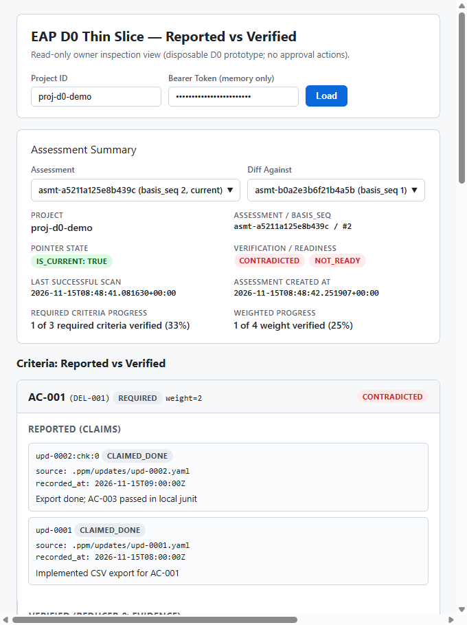

# Milestone acceptance — D0-thin-slice

## 1. Milestone and scope
Milestone **D0-thin-slice** delivers an end-to-end, fixtures-only demonstration of the PPM v2 assessment pipeline from a temporary fixture Git repository through the collector, ingest, pure deterministic reducer, Read API, and a disposable static inspection page (`web/hud/d0.html`), plus fixes for `ISS-035` and `ISS-036`.

Implemented scope:
1. **ISS-035 (Immutable approved baselines)** (`src/eap/ppm/assessments.py`, `src/eap/ppm/cli.py`):
   - `approve_baseline` locks the `(tenant_id, project_id, baseline_revision)` row.
   - If already `approved` with identical criteria (RFC 8785 JCS SHA-256), returns the existing row as a no-op without modifying `approved_by`, `approved_at`, or `source`.
   - If already `approved` with different criteria, raises `BaselineRevisionConflict` (`reason = "baseline_revision_conflict"`), requiring a new baseline revision; CLI exits with code `1` and emits `baseline_revision_conflict` on stderr.
2. **ISS-036 (`excluded_evidence[]` in Read API)** (`src/eap/ppm/assessments.py`):
   - `get_assessment_detail` derives `excluded_evidence[]` per criterion from locked `inputs` and reducer `output` without altering reducer semantics.
   - Each excluded item includes `evidence_id`, `revision`, `trust_class`, `test_id`, `simulated`, and exclusion `reason` (`revision_mismatch | trust_class_insufficient | test_not_mapped | ttl_expired | outside_baseline | unknown`).
   - Also returns `last_successful_scan_at` (latest captured `project_snapshots.created_at`, or `null`) and `notes` (verbatim context-only rows from `ppm_notes`).
3. **Idempotent demo scripts** (`scripts/demo_d0.sh`, `scripts/demo_d0.ps1`, `src/eap/ppm/cli.py`):
   - Prerequisite checks: `git >= 2.41.0`, `EAP_COLLECTOR_FIXTURES_ROOT` set, `EAP_COLLECTOR_ALLOW_REAL_ROOTS=false`, PostgreSQL reachable at `DATABASE_URL`.
   - Creates a deterministic fixture Git repo under `$EAP_COLLECTOR_FIXTURES_ROOT/d0_thin_slice_demo/repo`, commits `rev-r1` and `rev-r2`, migrates DB, registers source + scope via `LocationService`, approves baseline 1, loads simulated verifier evidence, scans + ingests + assesses `A1` and `A2`.
4. **Disposable static page** (`web/hud/d0.html`, `web/hud/src/D0App.tsx`, `web/hud/src/d0-main.tsx`, `web/hud/src/d0.css`, `web/hud/vite.config.ts`):
   - Vite multi-page entry with dev-server proxy for `/v1` and `/healthz` to `http://127.0.0.1:8000` (no CORS opening on API).
   - Bearer token kept in React memory only (password input, no `localStorage`, no URL param, never logged).
   - Renders Reported vs Verified columns per criterion, `"simulated verifier"` badge, `excluded_evidence` with reasons, `A1 -> A2` diff table, progress with denominators (or `"unknown"`, never `"0%"`), inert text rendering for `<script>` notes, and no approve/accept button.
5. **Documentation** (`docs/D0_DEMO.md`).

## 2. Source commit and environment pins
- Base commit: `5212796` (`main`)
- Branch: `wp/D0-thin-slice`
- Python: 3.12.13 (`uv` workspace)
- Database: PostgreSQL `18.6-trixie` (`eap_test`, isolated test container on `127.0.0.1:5433`)
- Node: `v26.7.0`, Vite `6.4.5`, Vitest `5.1.0`
- Git: `2.54.0.windows.1` (local), CI Linux `git >= 2.41.0`
- Fixtures-only mode: `EAP_COLLECTOR_ALLOW_REAL_ROOTS=false`, zero model/provider calls, zero network beyond `127.0.0.1`.

## 3. Real demo output (`scripts/demo_d0.ps1`)

```text
D0 thin slice demo complete.
  project_id:   proj-d0-demo
  rev-r1:       c7d6e0efdea28d71c2da8e3f9f3a9f3b9ae71ebb
  rev-r2:       83e622a40d9add50623ab5730ca61f9371054d5c
  A1_ID:        asmt-b0a2e3b6f21b4a5b
  A2_ID:        asmt-a5211a125e8b439c
  API base URL: http://127.0.0.1:8000
  Page URL:     http://127.0.0.1:5173/d0.html
```

## 4. A1, A2, and Diff JSON excerpts

### A1 (`asmt-b0a2e3b6f21b4a5b`, `rev-r1`) excerpt
```json
{
  "id": "asmt-b0a2e3b6f21b4a5b",
  "project_id": "proj-d0-demo",
  "basis_seq": 1,
  "assessed_revision": "c7d6e0efdea28d71c2da8e3f9f3a9f3b9ae71ebb",
  "is_current": false,
  "output": {
    "verification": "partially_verified",
    "acceptance_readiness": "not_ready",
    "progress": {
      "basis": "baseline_weighted",
      "total_weight": 4.0,
      "criteria_total": 3,
      "verified_weight": 2.0,
      "criteria_with_current_evidence": 1
    },
    "criteria": [
      {
        "criterion_id": "AC-001",
        "status": "verified",
        "reason_code": "evidence_current_pass",
        "reported_status": "claimed_done",
        "supporting_evidence_refs": ["ev-r1-verifier-run"]
      },
      {
        "criterion_id": "AC-002",
        "status": "unverified",
        "reason_code": "evidence_missing",
        "reported_status": "none"
      },
      {
        "criterion_id": "AC-003",
        "status": "unverified",
        "reason_code": "evidence_missing",
        "reported_status": "none"
      }
    ]
  }
}
```

### A2 (`asmt-a5211a125e8b439c`, `rev-r2`) excerpt
```json
{
  "id": "asmt-a5211a125e8b439c",
  "project_id": "proj-d0-demo",
  "basis_seq": 2,
  "assessed_revision": "83e622a40d9add50623ab5730ca61f9371054d5c",
  "last_successful_scan_at": "2026-11-15T08:48:41.081630+00:00",
  "is_current": true,
  "output": {
    "verification": "contradicted",
    "acceptance_readiness": "not_ready",
    "progress": {
      "basis": "baseline_weighted",
      "total_weight": 4.0,
      "criteria_total": 3,
      "verified_weight": 1.0,
      "criteria_with_current_evidence": 2
    }
  },
  "explanation": {
    "AC-001": {
      "reported": [
        {
          "claim_id": "upd-0002:chk:0",
          "source_file": ".ppm/updates/upd-0002.yaml",
          "reported_status": "claimed_done",
          "recorded_at": "2026-11-15T09:00:00Z"
        }
      ],
      "verified": {
        "status": "contradicted",
        "reason_code": "evidence_refuted",
        "refuting_evidence": [
          {
            "evidence_id": "ev-r2-verifier-fail",
            "trust_class": "verifier_observed",
            "producer": "simulated-verifier",
            "revision": "83e622a40d9add50623ab5730ca61f9371054d5c",
            "outcome": "failed",
            "test_id": "test_ac001_export",
            "simulated": true
          }
        ],
        "excluded_evidence": [
          {
            "evidence_id": "ev-r1-verifier-run",
            "trust_class": "verifier_observed",
            "producer": "simulated-verifier",
            "revision": "c7d6e0efdea28d71c2da8e3f9f3a9f3b9ae71ebb",
            "outcome": "passed",
            "test_id": "test_ac001_export",
            "simulated": true,
            "reason": "revision_mismatch"
          }
        ]
      }
    }
  }
}
```

### Diff JSON (`A1 -> A2`)
```json
{
  "project_id": "proj-d0-demo",
  "from_assessment_id": "asmt-b0a2e3b6f21b4a5b",
  "to_assessment_id": "asmt-a5211a125e8b439c",
  "from_basis_seq": 1,
  "to_basis_seq": 2,
  "from_assessed_revision": "c7d6e0efdea28d71c2da8e3f9f3a9f3b9ae71ebb",
  "to_assessed_revision": "83e622a40d9add50623ab5730ca61f9371054d5c",
  "changes": [
    {
      "criterion_id": "AC-001",
      "from_status": "verified",
      "to_status": "contradicted",
      "changed": true,
      "from_reason_code": "evidence_current_pass",
      "to_reason_code": "evidence_refuted",
      "from_evidence_revision": "c7d6e0efdea28d71c2da8e3f9f3a9f3b9ae71ebb",
      "to_evidence_revision": "83e622a40d9add50623ab5730ca61f9371054d5c",
      "reasons": [
        "status: verified -> contradicted",
        "reason_code: evidence_refuted",
        "Active refutation: verifier/test failure observed at revision 83e622a40d9add50623ab5730ca61f9371054d5c."
      ]
    },
    {
      "criterion_id": "AC-002",
      "from_status": "unverified",
      "to_status": "verified",
      "changed": true,
      "from_reason_code": "evidence_missing",
      "to_reason_code": "evidence_current_pass",
      "from_evidence_revision": null,
      "to_evidence_revision": "83e622a40d9add50623ab5730ca61f9371054d5c",
      "reasons": [
        "status: unverified -> verified",
        "reason_code: evidence_current_pass",
        "Verified by verifier_observed evidence at revision 83e622a40d9add50623ab5730ca61f9371054d5c."
      ]
    },
    {
      "criterion_id": "AC-003",
      "from_status": "unverified",
      "to_status": "unverified",
      "changed": false,
      "from_reason_code": "evidence_missing",
      "to_reason_code": "reported_artifact_only",
      "from_evidence_revision": null,
      "to_evidence_revision": null,
      "reasons": [
        "reason_code: reported_artifact_only",
        "In-repo test report authored by producer cannot verify deliverable criterion."
      ]
    }
  ]
}
```

## 5. Page screenshot and how the three D1 questions are answered



1. **Advancement**: The **Assessment Diff** table shows `AC-002` transitioning `unverified -> verified` (`evidence_missing -> evidence_current_pass`, `none -> 83e622a4...`). The `AC-002` **Verified** column displays `ev-r2-verifier-pass` (`verifier_observed`, `simulated verifier`, `test_ac002_login`) at `rev-r2`.
2. **Revision currency**: In the `AC-001` **Verified** column, **Excluded Evidence** lists `ev-r1-verifier-run` (`rev c7d6e0ef...`, `passed`, `simulated verifier`) with exclusion reason `revision_mismatch`, while **Refuting Evidence** lists `ev-r2-verifier-fail` (`rev 83e622a4...`, `failed`, `simulated verifier`).
3. **Why not accepted**: Header shows `CONTRADICTED` / `NOT_READY` (`1 of 3 required criteria verified (33%)`, `1 of 4 weight verified (25%)`). `AC-001` is `required` and `contradicted` despite `.ppm/updates/upd-0002.yaml` claiming `claimed_done`. `AC-003` is `unverified` (`reported_artifact_only`) with `ev-r2-ac003-reported` (`reports/ac003-junit.xml`, `reported_artifact`) excluded under `trust_class_insufficient`. No approve/accept button is present.

## 6. Executed checks and real output
- `CI=true TEST_DATABASE_URL=... uv run pytest -q` -> **623 passed** in 183.82s (PostgreSQL 18.6; includes ISS-035, ISS-036, `test_demo_d0_smoke.py` idempotency + 401/404 auth)
- `CI=true TEST_DATABASE_URL=... uv run python tools/run_sc06.py` -> **ALL CYCLES PASSED** (empty up/down/up + seeded down/up, head `0006_assessments`)
- `uv run python tools/validate_package.py` -> **PASS 16 schemas, 15 JSON fixtures, 11 events, 46 negative cases, PPM checks passed**
- `uv run python ppm-v2/tools/run_negative_cases.py` -> **PASS 5 templates, 20 cases**
- `uv run python ppm-v2/tools/check_fixtures.py` -> **PASS 23 fixtures, 3 rollup**
- `uv run python ppm-v2/tools/run_reducer_fixtures.py` -> **PASS 23 fixtures**
- `uv run python tools/check_translation.py` -> **SC-08 Report Summary: 38 up-to-date, 0 stale, 0 missing headers.**
- `uv run ruff check src tests ppm-v2/reducer migrations` -> **All checks passed!**
- `uv run mypy src tests ppm-v2/reducer migrations` -> **Success: no issues found in 160 source files**
- `npm --prefix web/hud test` -> **2 passed** (`D0App.test.tsx`: `<script>` inert text, missing denominator -> `"unknown"`, no approve button)
- `npm --prefix web/hud run build` -> **PASS** (`vite v6.4.5`, built `dist/index.html` and `dist/d0.html` in 410ms)
- `sha256sum -c SHA256SUMS.txt` -> regenerated with LF and verified
- GitHub Actions CI -> **pending push** (run ID to be recorded after push)

## 7. Residual risks and untested production controls
- **Simulated verifier**: D0 loads `simulated=True` evidence via `cli load-evidence`; real sandboxed verifier execution arrives in **P2a-WP9**.
- **ISS-034 still open**: `inputs_hash` includes `snapshot_seq`, `snapshot_refs`, and snapshot-derived `now` (addressed in P2a-WP5/WP6).
- **Untested production controls before real projects**:
  - **DG-3** (P0-WP6 Ollama throughput + D-06 local-only egress enforcement)
  - **P2a-WP9** (clean-environment verifier sandbox)
  - **P3a** (HUD projection snapshot API, SSE replay, and live permission revocation / C30)

## 8. Go/no-go
- Status: **ready_for_review** (awaiting owner inspection of `d0.html`, answers to the three D1 questions, and any `hud-feedback` issues before P3a-WP3).
- Rollback: zero data/schema impact (no new migrations; `d0.html` is disposable).
