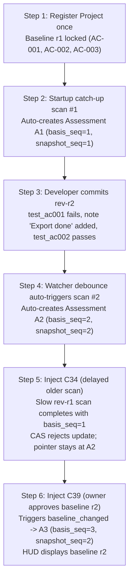

# DG-2: Scan Scheduling Policy, Reassessment Triggers, and Basis Sequence CAS

- **Status**: `signed` (owner decision 2026-11-07)

## 0. Owner Decision Record

- **Signed by**: xhuyvn (Huynn), project owner
- **Date**: 2026-11-07
- **Effect**: DG-2 closed together with DG-1 → **`P0 closed`**.

| Decision | Scope | Owner decision |
|---|---|---|
| DG-2.1 | Scheduler architecture (§2) | approve |
| DG-2.2 | Assessment ordering: ADR-021 rev 2 `basis_seq` CAS (§4) | approve |
| DG-2.3 | Scheduler operating policy: default 300 s, per-source override ≥ 60 s, debounce 5 s (§2.1) | approve |
| DG-2.4 | Reassessment triggers independent of file scanning (§3) | approve |
| DG-2.5 | Assessment input locking at task creation (§3.2) | approve |

### 0.1 Binding condition

| ID | Condition | Enforced by | Required evidence |
|---|---|---|---|
| DG2-C1 | Benchmark and test concurrency, lease/fencing and CAS **before any production deployment**. | P1a-WP3 (C33), P1a-WP4 (lease + fencing, C15), P2a-WP5 (C35), P2a-WP6 (C34, C39), P1a-WP7 / DG-5 (benchmark); production gate P5 | Concurrency tests with real parallel connections (not mocks of the DB); stale fencing token rejected; CAS loser recorded as history, current pointer never regresses; SC-07 benchmark report. No production deployment while any item lacks evidence. |

- **Date**: 2026-11-07
- **Authority**: Plan §3 (DG-2), §6 (P0-WP7, P2a-WP5..WP6, D1-fixture), `docs/01_DECISIONS_AND_SOURCE_RECONCILIATION.md` (ADR-021 rev. 2), `docs/04_PPM_INTEGRATION.md` (Round 3 & Round 4).
- **Enforces Conformance Cases**: C34, C35, C36, C39, C41, C44.

---

## 1. Context and Problem Statement

In enterprise agent operations, project state assessment must be continuous, responsive, and robust against race conditions:
1. **Out-of-Order Scan Completion (C34)**: If a developer commits new code while a long-running scan is executing, a newer scan may complete before the older scan. If the system uses "last-writer-wins", the older scan finishes last and overwrites the current pointer with stale results.
2. **Reassessments on Unchanged Code (C39, C41, C44)**: A repository's filesystem may not change at all, yet an assessment must re-execute because:
   - The project owner approved a new baseline revision (`baseline_changed`).
   - Active evidence supporting a criterion passed its time-to-live expiration (`evidence_ttl_expired`).
   - A previously failing LLM model has recovered (`model_recovered`).
   - An operator manually requested a fresh evaluation (`manual`).
   In these cases, `snapshot_seq` remains identical, making `snapshot_seq` alone insufficient to order assessments.
3. **Scan Contention and Resource Exhaustion**: Multiple scan triggers (rapid file saves, cron timers, host sleep wakeups) can trigger concurrent scanner storms on the same physical repository tree.

DG-2 defines the authoritative scheduler policy, the five independent reassessment triggers, the locking of assessment inputs at creation, and the `basis_seq` Compare-and-Set (CAS) pointer advancement rule (ADR-021 rev. 2).

---

## 2. Scheduler Policy (C35)

The PPM Scan Scheduler (`src/eap/ppm/scheduler.py`) runs as a platform module on top of the Task/Run Service, backed by the `ppm_scan_schedules` table. It avoids external OS-level cron daemons.

### 2.1 Configuration Parameters

| Parameter | Default Value | Minimum Allowed | Purpose |
|---|---|---|---|
| `interval_seconds` | `300` (5 minutes) | `10` | Periodic background polling interval when no file watcher events occur. |
| `debounce_seconds` | `5` | `1` | Coalescing window for filesystem change events (e.g. batch file saves or git checkouts). |
| `lease_duration_seconds` | `60` | `10` | Mutual-exclusion lease duration protecting active scan execution. |

### 2.2 Catch-up and Startup Policy
When the platform restarts, a host wakes up from sleep, or a network connector reconnects:
- The scheduler inspects all active schedules where `next_scan_at <= CURRENT_TIMESTAMP`.
- Rather than queuing a burst of missed executions (which would create a scanner stampede), the scheduler collapses all overdue intervals into **exactly ONE catch-up scan**.
- `last_scan_at` is updated to the current execution time, and `next_scan_at` is reset to `CURRENT_TIMESTAMP + interval_seconds`.

### 2.3 Concurrency and Mutual Exclusion per Source
- **Strict Invariant**: At most **one active scan task** may execute concurrently on any given physical source (`source_id`).
- **Enforcement Mechanism**:
  - The scheduler claims execution rights by acquiring a database lease on `ppm_scan_schedules`:
    ```sql
    UPDATE ppm_scan_schedules
    SET lease_holder = :worker_id,
        lease_expires_at = CURRENT_TIMESTAMP + INTERVAL '60 seconds',
        fencing_token = fencing_token + 1
    WHERE source_id = :source_id
      AND (lease_expires_at IS NULL OR lease_expires_at < CURRENT_TIMESTAMP);
    ```
  - If a scan is already running (lease is valid and unexpired), concurrent triggers (whether interval or file watcher) are debounced and deferred until the active scan completes.
- **Occurrence Deduplication**: Each scan execution is assigned a unique `occurrence_id` (e.g. `sha256(source_id|scheduled_time)`). Duplicate occurrence triggers are treated as no-ops.

---

## 3. Reassessment Triggers Independent of File Scanning

Unchanged file contents can still necessitate reassessment. The Assessment Orchestrator (`src/eap/ppm/orchestrator.py`) handles five distinct triggers:

| Trigger Enum | Trigger Ref | Condition | Bypasses Unchanged Scope? |
|---|---|---|---|
| `snapshot` | `snapshot_id` | Collector committed a new physical snapshot with altered tree hash. | **NO**. If the scope hash matches the prior snapshot, assessment is bypassed. |
| `baseline_changed` | `baseline_revision` | Owner approves a new baseline revision in PPM DB (C39, C44). | **YES** (evaluates new criterion/test mappings). |
| `evidence_ttl_expired` | `evidence_id + ":" + expiry` | Active evidence passed its validity threshold (D-03) (C41). | **YES** (demotes criterion from verified to stale). |
| `model_recovered` | `assessment_id` | Model Gateway confirms health of a model profile that previously timed out or failed (C36). | **YES** (re-runs analysis step to extract claims). |
| `manual` | `request_id` | Operator or reviewer manually clicks "Re-assess" in HUD or API. | **YES** (forces full reconciliation). |

### 3.1 Task Deduplication
Assessment tasks are deduplicated at admission by the tuple:
`UNIQUE (project_id, trigger, trigger_ref)`
If an assessment task for the exact same trigger reference is already queued or running, the admission request returns the existing task reference (`202 Accepted`) rather than spawning duplicate runs.

### 3.2 Input Locking at Creation Time
At the exact moment an assessment task is created:
1. It is assigned a strictly monotonic integer `basis_seq` for that `project_id`.
2. All inputs required for the assessment are **locked**:
   - `snapshot_id`: The latest committed snapshot for the project scope.
   - `snapshot_seq`: The sequence number of that snapshot.
   - `baseline_revision`: The active approved baseline revision at creation time.
   - `policy_version` and evidence TTL configuration.
3. This guarantees that even if a new baseline is approved 50 milliseconds later, this assessment task evaluates strictly the inputs it locked, and the Compare-and-Set rule ensures it will not overwrite any newer assessment.

---

## 4. Current-Assessment Rule: ADR-021 rev. 2 (`basis_seq` CAS)

### 4.1 Definition of `basis_seq`
`basis_seq` is a monotonically increasing 64-bit integer assigned per `(tenant_id, project_id)` at assessment-task **creation time**, across all triggers.
- While `snapshot_seq` orders physical filesystem snapshots, `basis_seq` orders **assessment evaluations and input states**.
- Multiple assessments may legitimately share the same `snapshot_seq` (e.g. initial snapshot scan, followed by a baseline change, followed by evidence TTL expiration, all on the same code commit).
- `basis_seq` provides total ordering across all assessments for a project.

### 4.2 Compare-and-Set (CAS) Pointer Update Rule
The active pointer is maintained in the `project_current_assessment` table:
```sql
CREATE TABLE project_current_assessment (
    tenant_id VARCHAR(64) NOT NULL,
    project_id VARCHAR(64) NOT NULL,
    assessment_id VARCHAR(64) NOT NULL,
    basis_seq BIGINT NOT NULL,
    snapshot_seq BIGINT NOT NULL,
    baseline_revision INTEGER,
    updated_at TIMESTAMPTZ NOT NULL DEFAULT CURRENT_TIMESTAMP,
    PRIMARY KEY (tenant_id, project_id)
);
```

When an assessment finishes, the orchestrator executes the CAS update:
```sql
UPDATE project_current_assessment
SET assessment_id = :incoming_assessment_id,
    basis_seq = :incoming_basis_seq,
    snapshot_seq = :incoming_snapshot_seq,
    baseline_revision = :incoming_baseline_revision,
    updated_at = CURRENT_TIMESTAMP
WHERE tenant_id = :tenant_id
  AND project_id = :project_id
  AND basis_seq < :incoming_basis_seq;
```

### 4.3 Behavioral Invariants

#### Case 1: Out-of-Order Scan Completion (C34)
- At $t_1$, Scan A starts on commit `rev-r1`. Task Orchestrator creates Assessment Task A: `basis_seq = 1`, `snapshot_seq = 1`.
- At $t_2$, user commits `rev-r2`. Scan B starts. Task Orchestrator creates Assessment Task B: `basis_seq = 2`, `snapshot_seq = 2`.
- At $t_3$, Scan B finishes. CAS executes: $2 > 0$ -> Pointer moves to Assessment B. HUD renders Assessment B.
- At $t_4$, Scan A finishes late. CAS executes: incoming `basis_seq` is 1, but current `basis_seq` in database is 2.
- **Outcome**: The CAS `UPDATE` affects 0 rows. Assessment A is persisted into immutable assessment history (`assessments` table), but **the current pointer remains at Assessment B**. HUD never reverts to Assessment A.

#### Case 2: Baseline Modification on Identical Snapshot (C39)
- Repo remains unchanged on commit `rev-r2` (`snapshot_seq = 2`).
- An in-flight assessment task evaluating baseline 1 is running with `basis_seq = 2`.
- Project owner approves baseline revision 2.
- The `baseline_changed` trigger immediately creates Assessment Task C: `basis_seq = 3`, `snapshot_seq = 2`, `baseline_revision = 2`.
- Even if the older baseline 1 task finishes after Task C was initiated, Task C has `basis_seq = 3`.
- **Outcome**: Assessment C supersedes Assessment B. The HUD displays `baseline_revision = 2` and will not be overwritten by any delayed older baseline execution.

---

## 5. D1-Fixture Scenario Walkthrough Demonstrating DG-2

The D1-fixture scenario (`scripts/demo_d1.ps1` / `scripts/demo_d1.sh`) provides the end-to-end verification of DG-2 policies:



### Detailed Sequence of Events in D1:
1. **Initial Registration**: Project registered once via `POST /v1/ppm/locations` with baseline revision 1. Criteria:
   - `AC-001`: Mapped to `test_ac001_export`.
   - `AC-002`: No tests yet mapped.
   - `AC-003`: In-repo agent report claim.
2. **Scan #1 (Startup Catch-up)**:
   - Scheduler executes catch-up scan.
   - Produces Assessment A1 (`snapshot_seq = 1`, `basis_seq = 1`):
     - `AC-001`: `verified` (passing test on `rev-r1`).
     - `AC-002`: `unverified`.
     - `AC-003`: `reported_artifact_only`.
3. **Code Mutation at `rev-r2`**:
   - `test_ac001_export` fails on `rev-r2`.
   - Developer adds note: "Export done".
   - Developer adds passing test for `AC-002`: `test_ac002_login`.
4. **Scan #2 (Debounce & Auto-Scan)**:
   - Debounce coalesces file writes (5s).
   - Scheduler executes scan #2 without manual operator invocation.
   - Produces Assessment A2 (`snapshot_seq = 2`, `basis_seq = 2`):
     - `AC-001`: `contradicted` (developer claim "done", but verifier observed FAIL report on `rev-r2`).
     - `AC-002`: `verified` (`test_ac002_login` passed on `rev-r2`).
     - `AC-003`: `reported_artifact_only`.
   - CAS on `basis_seq` ($2 > 1$) updates `project_current_assessment` to A2.
5. **C34 Invariant Test**:
   - A synthetic delayed scan from `rev-r1` completes with `basis_seq = 1`.
   - CAS comparison fails ($1 \ngtr 2$). A1 remains in history; current pointer stays on A2.
6. **C39 Invariant Test**:
   - Owner updates baseline to revision 2.
   - Trigger `baseline_changed` creates Assessment A3 with `basis_seq = 3` and identical `snapshot_seq = 2`.
   - CAS succeeds ($3 > 2$). HUD displays Assessment A3.

---

## 6. Decision Alternatives and Trade-Off Analysis

### 6.1 Scheduler Architecture
- **Options Considered**:
  - *Option A (Chosen)*: PPM Scan Scheduler as internal module on Task/Run Service with database leases.
  - *Option B*: Operating system cron (`cron` / Windows Task Scheduler) invoking CLI tools.
  - *Option C*: Redis-based distributed scheduler (e.g. Celery / BullMQ).
- **Rationale for Option A**:
  - Eliminates secondary external infrastructure for single-node deployments.
  - Guarantees full audit logging, unified state tracking, and shared lease fencing within PostgreSQL.
- **Rejection of Option B**: Lacks central audit visibility, unable to perform transactional catch-up deduplication, and creates external platform dependencies.
- **Rejection of Option C**: Violates ADR-026 (Redis is optional profile, storing derived data only; work queues reside in PostgreSQL).
- **Reversibility**: Moderate.

### 6.2 Ordering via `basis_seq` vs `snapshot_seq` (ADR-021 rev. 2)
- **Options Considered**:
  - *Option A (Chosen)*: CAS on `basis_seq` (issued at assessment task creation across all triggers).
  - *Option B*: CAS strictly on `snapshot_seq`.
  - *Option C*: Wall-clock timestamp comparison (`updated_at`).
- **Rationale for Option A**:
  - Solves the identical snapshot reassessment problem (C39, C41, C44).
  - Preserves deterministic monotonically increasing integer comparisons without distributed clock drift or leap second anomalies.
- **Rejection of Option B**: Cannot order multiple assessments that share the same commit/snapshot (e.g. baseline change or TTL expiry on unchanged code).
- **Rejection of Option C**: Prone to NTP clock skew, virtualization time-jumps, and millisecond-level race conditions.
- **Reversibility**: Low. Core concurrency invariant.
- **Evidence that would alter decision**: None. Integer sequence CAS is standard practice for deterministic state machines.

---

## 7. Sequence Diagrams

All sequence diagrams for C34 and C39 are documented in [`sequences.md`](sequences.md).
