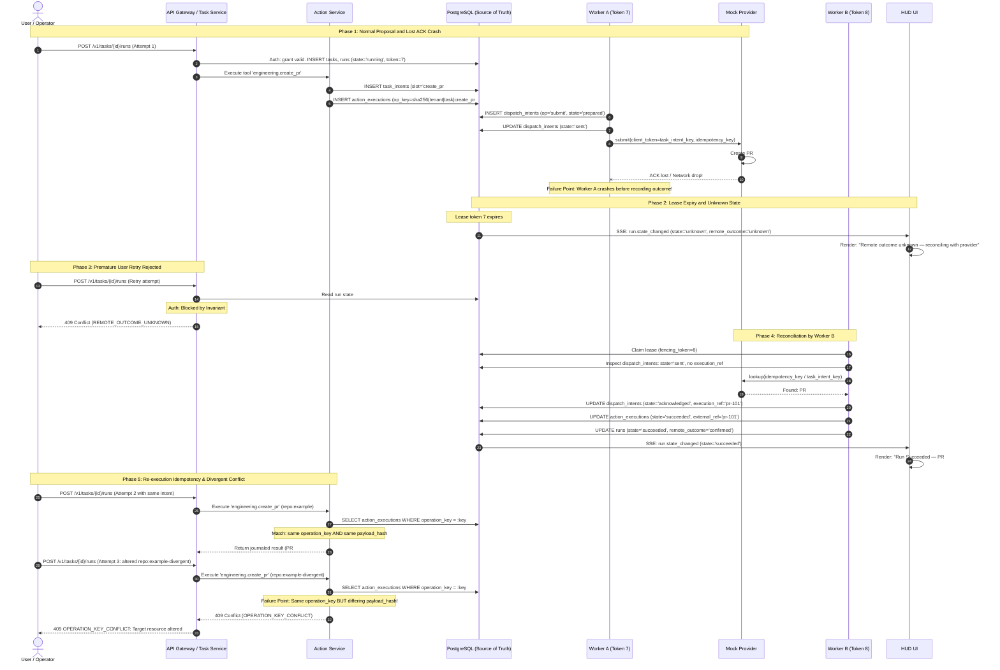
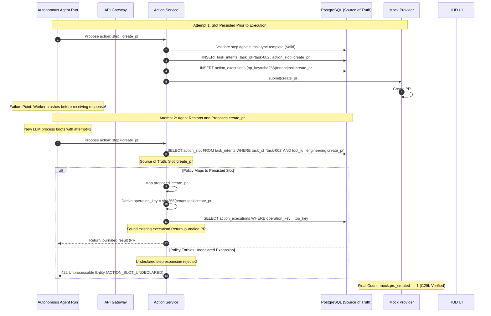

# Sequence Diagrams for Conformance Cases

This document details the normative sequence diagrams for Conformance Cases **C29**, **C29b**, **C33**, **C34**, and **C39**, supporting decisions **DG-1** and **DG-2**.

Each diagram illustrates:
- The **Caller / Actor**
- The **Authorization Decision**
- The **Source of Truth**
- The **Persisted State**
- The **Failure Point**
- The **HUD Display** while outcomes are unknown or in-flight

---

## 1. Conformance Case C29: Lost ACK, Worker Restart, User Retry, and Conflict Detection

In C29, the provider mock creates a pull request, but the network acknowledgment is lost, and Worker A crashes. A user retry attempt while the run is unknown is rejected. After reconciliation, the retry reuses the persisted `operation_key` and returns the journaled result without duplicating the PR. A retry with a divergent target repository is rejected with `409 OPERATION_KEY_CONFLICT`.



---

## 2. Conformance Case C29b: Agent Proposes New Slot After Restart

In C29b, an autonomous native LLM agent restarts after a crash and attempts to declare a new slot name (`create_pr#2` instead of `create_pr#1`). The Action Service recovers the persisted slot from `task_intents` (or rejects undeclared slots), preventing duplicate external PR creation.



---

## 3. Conformance Case C33: Outbox Relay Offset Assignment in Commit Order

In C33, two concurrent transactions acquire sequential IDs 10 and 11, but Transaction 11 commits before Transaction 10. A single outbox relay holding an advisory lock assigns `ingest_offset` post-commit in commit order, ensuring clients replaying from cursors never miss events.

```mermaid
sequenceDiagram
    autonumber
    participant TxA as Worker A (Tx 10)
    participant TxB as Worker B (Tx 11)
    participant Outbox as outbox Table (No Offset)
    participant Relay as Single Outbox Relay Worker
    participant EventLog as event_log Table (With ingest_offset)
    participant Client as HUD SSE Client

    Note over TxA,Outbox: Tx A and Tx B execute concurrently
    TxA->>Outbox: BEGIN; INSERT outbox (id=10, event='task.started'); [HOLD]
    TxB->>Outbox: BEGIN; INSERT outbox (id=11, event='task.progress');
    
    Note over TxB,Outbox: Failure Point: Tx 11 commits FIRST!
    TxB->>Outbox: COMMIT (Tx 11 committed at t1)
    
    Note over Relay,EventLog: Relay acquires advisory lock and polls committed rows
    Relay->>Relay: pg_advisory_xact_lock(tenant_stream_hash)
    Relay->>Outbox: SELECT * FROM outbox ORDER BY committed_at / xmin
    Note over Relay: Only Tx 11 is committed! Tx 10 is still in-flight.
    Relay->>EventLog: INSERT event_log (stream='tenant-1', ingest_offset=101, event='task.progress')
    Relay->>Client: SSE Push: event='task.progress', id=101
    Client->>Client: Cursor advanced to 101
    
    Note over TxA,Outbox: Tx 10 commits LATER!
    TxA->>Outbox: COMMIT (Tx 10 committed at t2 > t1)
    
    Note over Relay,EventLog: Next Relay Poll
    Relay->>Outbox: SELECT * FROM outbox WHERE id=10
    Relay->>EventLog: INSERT event_log (stream='tenant-1', ingest_offset=102, event='task.started')
    Relay->>Client: SSE Push: event='task.started', id=102
    Client->>Client: Cursor advanced to 102
    
    Note over Client,EventLog: Replay Verification
    Client->>EventLog: GET /v1/hud/events?cursor=100
    EventLog-->>Client: Returns [101 (progress), 102 (started)]
    Note over Client: Zero events skipped! Replay exactly matches state snapshot.
```

---

## 4. Conformance Case C34: Delayed Older Scan Overwrite Protection (basis_seq CAS)

In C34, Scan A starts on commit `rev-r1`, Scan B starts on commit `rev-r2` and finishes first. When Scan A completes later, the `basis_seq` CAS rule rejects updating the current pointer.

```mermaid
sequenceDiagram
    autonumber
    participant Sched as Scan Scheduler
    participant Orch as Assessment Orchestrator
    participant ScanA as Scan Worker A (rev-r1)
    participant ScanB as Scan Worker B (rev-r2)
    participant PCA as project_current_assessment
    participant History as assessments (History)
    participant HUD as HUD UI

    Note over Sched,ScanA: t1: Scan A starts on commit rev-r1
    Sched->>Orch: Trigger 'snapshot' for rev-r1
    Orch->>Orch: Issue basis_seq = 1, snapshot_seq = 1
    Orch->>ScanA: Execute Collector & Reducer (rev-r1)
    
    Note over Sched,ScanB: t2: Developer commits rev-r2. Scan B starts!
    Sched->>Orch: Trigger 'snapshot' for rev-r2
    Orch->>Orch: Issue basis_seq = 2, snapshot_seq = 2
    Orch->>ScanB: Execute Collector & Reducer (rev-r2)
    
    Note over ScanB,HUD: t3: Scan B finishes FIRST!
    ScanB->>PCA: UPDATE ... SET assessment_id='A2', basis_seq=2 WHERE basis_seq < 2
    Note over PCA: CAS Succeeds (2 > 0). Current Pointer = A2
    PCA->>HUD: SSE: ppm.assessment.updated (assessment_id='A2', rev='rev-r2')
    HUD->>HUD: Render: Current Assessment A2 (rev-r2)
    
    Note over ScanA,HUD: t4: Failure Point: Scan A finishes LATE!
    ScanA->>PCA: UPDATE ... SET assessment_id='A1', basis_seq=1 WHERE basis_seq < 1
    Note over PCA: CAS Fails! (Current basis_seq is 2; 1 < 2 is False. 0 rows updated)
    ScanA->>History: INSERT assessments (assessment_id='A1', basis_seq=1, status='historical')
    Note over HUD: HUD does NOT revert! Pointer remains firmly on A2.
```

---

## 5. Conformance Case C39: Baseline Update During In-Flight Assessment on Identical Code

In C39, repository code remains unchanged (`snapshot_seq = 2`), but the project owner approves baseline revision 2 while an assessment for baseline revision 1 is in-flight. The `baseline_changed` trigger creates a task with a higher `basis_seq`, preventing the older baseline assessment from becoming current.

```mermaid
sequenceDiagram
    autonumber
    actor Owner as Project Owner
    participant Orch as Assessment Orchestrator
    participant TaskOld as Assessment Task 1 (Baseline r1)
    participant TaskNew as Assessment Task 2 (Baseline r2)
    participant PCA as project_current_assessment
    participant HUD as HUD UI

    Note over Orch,TaskOld: t1: Snapshot 2 committed; Assessment 1 starts
    Orch->>TaskOld: Create Task: basis_seq=1, snapshot_seq=2, baseline_revision=1
    Note over TaskOld: Locked inputs: snapshot=2, baseline=1
    
    Note over Owner,Orch: t2: Owner approves Baseline r2 while Task 1 is running
    Owner->>Orch: Approve Baseline Revision 2
    Orch->>TaskNew: Trigger 'baseline_changed': basis_seq=2, snapshot_seq=2, baseline_revision=2
    Note over TaskNew: Locked inputs: snapshot=2, baseline=2
    Orch->>HUD: SSE: "Reassessing project on baseline revision 2..."
    HUD->>HUD: Display: "Baseline r2 active — reassessment in progress"
    
    Note over TaskOld,PCA: t3: Failure Point: Old Baseline Task 1 finishes LAST!
    TaskOld->>PCA: UPDATE ... SET assessment_id='A_old', basis_seq=1 WHERE basis_seq < 1
    Note over PCA: If Task 2 already completed (basis_seq=2), CAS rejects Task 1!
    Note over PCA: If Task 2 is still running, Task 1 temporarily writes basis_seq=1, then Task 2 overwrites with basis_seq=2!
    
    Note over TaskNew,HUD: t4: New Baseline Task 2 completes
    TaskNew->>PCA: UPDATE ... SET assessment_id='A_new', basis_seq=2 WHERE basis_seq < 2
    Note over PCA: CAS Succeeds (2 > 1). Current Pointer = A_new (baseline r2)
    PCA->>HUD: SSE: ppm.assessment.updated (assessment_id='A_new', baseline_revision=2)
    HUD->>HUD: Render: Current Assessment A_new with Baseline Revision 2
```
