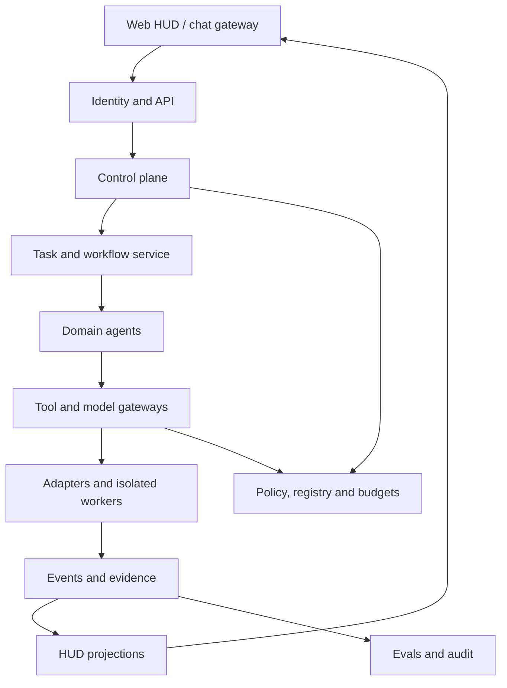

> Translated from MASTER_BLUEPRINT.md @ a36d44e

# Enterprise Agent Platform với Agent Operations HUD
## Integrated Blueprint 1.1
Ngày 05/11/2026, revision 1.1 ngày 06/11/2026 theo `docs/ARCHITECTURE_REVIEW.md` (ADR-011–ADR-016). Repository hiện chỉ có specification, contracts, fixtures và validators; chưa có application code. Phạm vi một công ty với nhiều phòng ban, project và agent. Pilot một workspace có thể vận hành trên local hoặc private server. Company/tenant_id là boundary dữ liệu ngay từ đầu.

## 1. Mục tiêu và kết quả
Platform đăng ký agent, giao task, chạy workflow, kiểm tra quyền, lưu bằng chứng và cung cấp HUD để giám sát/can thiệp. PPM v2 là domain đầu tiên, quản lý inventory theo location path và đồng bộ `.ppm/`. Các domain khác tham gia qua cùng integration contract.

Kết quả cần đạt gồm inventory agent có owner/version, task/run có lịch sử, tiến độ PPM có nguồn, approval gắn hành động chính xác, chi phí theo task tree và agent release có eval evidence. Phase 2 cải tiến harness dựa trên trace và experiment.

### Phân kỳ
| Phase | Kết quả |
|---|---|
| Phase 1 | Platform core, HUD, PPM v2, onboarding kit, một adapter thực và pilot vận hành |
| Phase 2 | Harness Optimization Agent, context/retrieval/model-routing experiments, canary/rollback, mở rộng domain theo ưu tiên |

Phase 1 phải bao gồm (chưa triển khai) authentication, authorization, durable run journal, idempotency, sandbox profile, budgets, audit và eval baseline. Phase 2 tối ưu chất lượng/hiệu suất trên nền tảng đã đo được.

## 2. Kiến trúc

Control plane sở hữu registry, version/deployment, policy, task admission và budgets. Execution plane sở hữu workflow nodes, adapter dispatch, worker leases và cancellation. Data plane có domain DB, evidence blobs, document corpus và rebuildable search indexes. Assurance plane có trace, audit, evals, incidents và release gates.

### Trách nhiệm dịch vụ
| Module | Trách nhiệm | Owner nghiệp vụ |
|---|---|---|
| Agent Registry | Agent definition, release, capability certification | Platform team + business owner |
| Task Service | Objective, input/output refs, dependencies, task tree | Domain requesting task |
| Run Service | Attempts, dispatch, provider session, checkpoint | Platform |
| Domain Services | Project, risk, document, editorial business rules | Domain owner |
| Policy/Action Service | Tool permissions, exact action approvals, execution journal | Security + platform |
| Model Gateway | Provider/model profile, egress, quota, usage | Platform/data owner |
| Evidence Service | Immutable artifacts, revision/hash, lineage/access | Producer + data owner |
| HUD Projection | User-scoped views, attention queue, run detail | Operations |
| Harness Optimization | Candidate proposals, experiments, release evidence | Phase 2 engineering owner |

## 3. Topology triển khai
Pilot local gồm API/worker/PostgreSQL, evidence directory và web HUD. Máy Windows chạy local connector, workspace manager và Ollama riêng. Deployment server dùng Ubuntu/Docker/Traefik, OIDC và HTTPS. Connector mở kết nối outbound có authentication tới server, nhận job scoped theo host và roots đã đăng ký. Domain objects dùng logical location_id, connector resolve path trên host. Trong local MVP connector là module chạy cùng process worker trên cùng máy, dùng cùng contract `location-registration` 1.1; tách thành service outbound chỉ khi chuyển sang private server. Không thêm service riêng cho Evidence/HUD Projection/Policy trong pilot: đây là module của modular monolith có ranh giới API nội bộ.

Một tenant pilot với OIDC hoặc bootstrap identity loopback cho cá nhân. Bật multi-user/network exposure phải qua OIDC + resource authorization trước rollout. Secret giữ trong credential store và deployment config, API response chỉ trả credential reference.

SQLite có thể là local spool của connector khi offline. PostgreSQL là authoritative platform state. Connector replay spool qua dedup keys. Shared filesystem writes bị giới hạn bằng workspace isolation và process ownership. Một writer/integration worker cho target branch.

Cấu hình máy từng thảo luận là giả định pilot, cần benchmark trước capacity commitment. Ollama concurrency khởi đầu 1 trên GPU local, GPU render/OCR và interactive inference dùng queue quotas riêng. Provider/model IDs là deployment config được probe trước sử dụng.

## 4. Stack và orchestration owner
Backend Python/FastAPI/Pydantic; PostgreSQL/SQLAlchemy/Alembic; React/TypeScript cho HUD. Run Service (PostgreSQL) là owner duy nhất của task/run/attempt state, dispatch journal, lease/fencing và cancellation (ADR-011). LangGraph chỉ dùng bên trong một run attempt của native domain agent để điều phối các bước suy luận; checkpoint LangGraph keyed theo run_id+attempt, là dữ liệu nội bộ có thể rebuild, không phải nguồn trạng thái cho HUD hoặc retry. LangGraph replay chạy lại node từ đầu, nên graph node không gọi external side effect trực tiếp; mọi side effect đi qua Action Service/tool gateway với operation_key và execution journal. Domain reducer sở hữu business mutation. Work queue pilot là bảng PostgreSQL với `FOR UPDATE SKIP LOCKED` lease, không thêm message broker khi chưa có số đo.

Provider SDK gọi qua Model Gateway. Claude Agent SDK, Codex, OpenCode và agent HTTP/CLI bên ngoài đi qua adapter boundary. Runtime có agent loop riêng được quản lý như child execution với correlation ID và caps. Pydantic AI/Deep Agents là candidate runtime trong phase 2 hoặc adapter độc lập được certify. Temporal chỉ được đưa vào qua ADR migration chỉ rõ workflow nào chuyển ownership và cách xử lý in-flight runs.

PostgreSQL full text và metadata đáp ứng pilot PPM. Knowledge có thể bổ sung pgvector hoặc Qdrant sau retrieval benchmark. Object store S3-compatible được dùng khi tách workers hoặc retention/backup yêu cầu, filesystem content-addressed đủ cho local pilot. OpenTelemetry/OTLP cho traces, evidence/audit có lifecycle riêng.

## 5. Agent, task, run và acceptance
AgentDefinition có capabilities đề xuất. AgentRelease là cấu hình immutable có bundle digest. DeploymentBinding gắn release với runtime, endpoint, secrets, scope và capability đã kiểm chứng. AgentInstance/Worker là process sống. Task là yêu cầu nghiệp vụ. Run là một attempt. ProviderSession là identity bên vendor.

Task states gồm draft, ready, active, blocked, review_required, completed, failed, cancelled. Run states gồm queued, dispatching, running, waiting_approval, cancelling, succeeded, failed, cancelled, timed_out, unknown. Connectivity có healthy/stale/offline riêng. Remote outcome (known/unknown) là trục riêng: run `unknown` nghĩa là platform không biết provider đã nhận hay đã thực hiện; HUD không được hiển thị nó như failed hoặc retry được. Cancel trên run unknown được ghi thành intent và chỉ thực thi sau reconciliation (docs/02). PPM verification và acceptance là hai trục domain riêng.

Run succeeded chỉ cung cấp result để domain verifier đánh giá. Một scan task có thể completed khi snapshot intake hợp lệ, trong khi project vẫn chưa accepted. Task completed phải theo completion policy của task type. Retry tạo run mới với attempt +1, giữ history. Resume checkpoint giữ run identity khi continuation hợp lệ và được adapter hỗ trợ.

## 6. Các domain và quan hệ
PPM sở hữu project/program/portfolio, acceptance criteria, dependencies, benefits và status assessment. Knowledge sở hữu document versions, source ACLs, effective dates và citations. Governance/Risk sở hữu requirements/control mappings và review workflow. Research sở hữu source registry, event clustering, briefings. Productivity sở hữu reminder/subscription; dùng project IDs từ PPM. Editorial và Media sở hữu draft/revision/publish/render lifecycle. Engineering/Operations là execution domains có quyền scoped.

Secretary là giao diện và routing layer qua web/chat, dùng cùng Task Service và Action Service. Chat identity được map bằng credential/verified binding. Domain agents trao đổi typed task/result refs. Synthesis agent chỉ truy cập resource scope được ủy quyền.

## 7. Data và trust boundaries
Mọi API có tenant boundary từ authenticated context. Retrieval lọc quyền trước tìm kiếm và kiểm tra lại khi đọc/cite. Domain DB là nguồn cho objective/baseline/approval. Evidence có artifact ID, hash, revision, producer và classification. Run memory có checkpoint/context summaries, mọi summary gắn derived_from và freshness.

Cloud Policy C cho phép egress theo quyền, mục đích, classification và provider approval. Check cả embeddings, telemetry và fallback provider. Binding 1.1 liệt kê `fallback_model_profile_refs`, `embedding_profile_ref`, `egress_policy_ref` và `telemetry_export`; Model Gateway deny-by-default mọi profile không có trong binding, kể cả khi provider chính lỗi. OTLP/trace export mặc định `local_only`. Model gateway từ chối nếu thiếu policy hoặc profile chưa được authorize. Tool outputs, repo docs, `.ppm` notes/updates, MCP và websites là data untrusted: chúng chỉ có thể trở thành claim, không thể đổi trạng thái verified/accepted, cấp quyền hoặc kích hoạt tool. Tool execution có server-side enforcement. `tenant_id` trong producer event được ingestion so khớp với binding đã xác thực; lệch thì quarantine. Vendor runtime tự thực thi tool phía server (ví dụ built-in toolset của Claude Managed Agents) nằm ngoài Action Service và phải khai báo `execution_boundary=external_trusted` trừ khi các tool đó bị tắt (docs/06).

## 8. HUD
HUD chính gồm attention queue, tasks/runs table, agent health và capacity, project overview, trace inspector, approvals, artifacts và version/eval views. Mọi trạng thái có as_of, source, coverage và connectivity. UI gửi command tới API, server kiểm tra capability/permission/current revision trước thực thi.

Tiến độ chỉ hiển thị x/y hoặc percent khi denominator có căn cứ. Task research có current stage và elapsed time. Chi phí có actual/estimated/partial/unknown marker (partial là lower bound khi có call chưa biết cost; tổng không bao giờ cộng unknown như 0), provider_usage_as_of và scope để tránh cộng trùng cumulative counts. Cost ceiling dựa vào reservation + reconciliation, có thể phát sinh usage chưa báo cáo và cần giới hạn concurrency/token trong dispatch.

## 9. Phase 2 harness initiative
Harness Optimization Agent đọc các trace đã được phép, phân loại failure, tạo hypothesis, candidate patch/config, chạy offline controlled experiments, đề xuất release. Experiment Service và người review quản lý test set, secret/holdout và promotion. Mỗi candidate pin model profile/prompt/tools/retrieval policy và source revision.

Harness package gồm context builder, tool contracts, planning/termination rules, retry/recovery, memory/compaction, verification và telemetry. Candidate được đánh giá quality, completion, grounding, tool correctness, cost, latency, retries và security regression. Canary có rollback trigger trước rollout.

## 10. Quyền và trách nhiệm
Business owner xác định outcome/acceptance. Platform owner vận hành registry/runtime. Data owner cấp phạm vi dữ liệu. Security owner xác nhận policy profiles. Reviewer nghiệm thu. Operator can thiệp task trong quyền đã cấp. Với pilot cá nhân một người có thể kiêm vai trò, audit vẫn ghi actor và quyết định rõ ràng.

Agent package tự khai quyền mong muốn. Trusted deployment binding mới cấp capability hiệu lực. Human approval gắn action digest, target revision, expiry, approver scope. Dịch vụ kiểm tra lại khi thực thi và consume một lần bằng transaction. Credential revocation chặn dispatch/tool calls mới và kích hoạt cancellation/reconciliation với remote work đang chạy.

## 11. Roadmap và bàn giao
Phase 1 gồm P0 contract/discovery, P1 control plane, P2 PPM intake, P3 HUD, P4 PPM program/portfolio + adapter pilot, P5 hardening/acceptance. Local MVP là lát cắt P0+P1a+P2a+P3a kết thúc bằng D1-fixture (đăng ký một lần, scheduler tự quét lần hai sau khi project đổi → HUD trả lời: tiêu chí nào tiến thêm, bằng chứng nào thuộc đúng revision, vì sao mục agent báo "đã xong" chưa đủ nghiệm thu) rồi Local-pilot (thư mục thật + Ollama thật); shared pilot cần thêm P1b, P3b, P4, P5. Work packages, dependencies và acceptance evidence nằm trong `docs/IMPLEMENTATION_PLAN.md`. Phase 2 gồm H0 baseline, H1 context/tool experiments, H2 Harness Optimization Agent, H3 canary/rollbacks.

Chi tiết API/state transitions, HUD behavior, templates, onboarding, eval/operations và các quyết định hợp nhất nằm trong các tài liệu đi kèm. Gate được nghiệm thu bằng runtime evidence tại implementation, package hiện tại kiểm tra structure/examples và tính nhất quán thiết kế.
