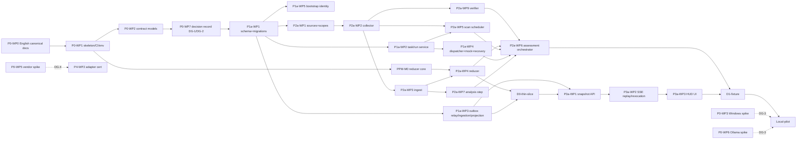

> Translated from docs/IMPLEMENTATION_PLAN.md @ d7c9e91

# Implementation Plan — Enterprise Agent Platform 1.1 (plan revision 1.5)

Ngày 06/11/2026. Nguồn: `MASTER_BLUEPRINT.md` 1.1, `docs/ARCHITECTURE_REVIEW.md`, `docs/01` (ADR-011…026), `docs/DEV_ENVIRONMENT.md`, contracts 1.1. Milestone IDs giữ theo `docs/07` (P0–P5, H0–H3); hậu tố `a`/`b` tách phần local MVP và phần shared pilot.

## 0. Thay đổi so với plan 1.1 (góp ý của owner, vòng 3)
| Góp ý | Thay đổi trong plan 1.2 |
|---|---|
| Tự quét location đã đăng ký | WP mới **P2a-WP5 Scan Scheduler** sở hữu lịch quét; D1 chỉ đăng ký một lần, lần quét thứ hai do scheduler tự chạy; kiểm chạy lại không nhân đôi (C35) |
| Tách demo fixture và local pilot | Hai mốc **D1-fixture** (thư mục tạm, mock, fake model) và **Local-pilot** (thư mục thật, Ollama thật). P0 exit không còn đòi spike Ollama/Windows; mỗi spike gắn vào đúng gate (§3) |
| Idempotency qua nhiều attempt | DG-1 chốt trước migration đầu tiên: ai cấp khóa, phạm vi unique, phát hiện cùng khóa khác payload; bảng `task_intents`, `action_executions` (unique tenant+operation_key, lưu payload_hash) tách khỏi `dispatch_intents` (theo run); C29, C38 |
| Bằng chứng mâu thuẫn trên cùng tiêu chí | Fixture đổi: **AC-001** có note "đã xong" + PASS rev-r1 + FAIL do collector thu ở rev-r2. P2a-WP4 giải thích theo nguồn, revision, baseline, phạm vi test; P2b-WP2 từ chối nghiệm thu vì AC-001 là required |
| Monorepo và shared component | Tách `source` vật lý khỏi project scope (`source_id`, ADR-022); P2a-WP1/WP6 kiểm hai project cùng repo + component dùng chung; sửa note của A không đổi assessment của B (C32) |
| HUD replay và thu hồi quyền | Offset do outbox relay cấp theo thứ tự commit (ADR-020), test commit 11 trước 10 (C33); thu hồi quyền khi SSE mở + chính sách evidence đã chốt: không signed URL (C30) |
| Benchmark và dung lượng | Tách **đo baseline** (P1a-WP7, P2a-WP8, P3a-WP4, Local-pilot) khỏi **nghiệm thu theo ngưỡng đã duyệt** (DG-5 → P5-WP4); danh sách số đo bắt buộc (SC-07) |
| Truy vết finding, chất lượng Phase 2 | §9 có đủ ARCH-01…33 với `design_status` và `runtime_evidence`; H0-WP2 kiểm runner bằng output cố định, đo biến động baseline, cho phép `inconclusive` |
| P5 phụ thuộc ngược Phase 2 | §5 ma trận case → milestone; P5-WP2 liệt kê từng case; C26 thuộc H1; SC-03 chỉ đòi case đến hạn; prerequisite P5-WP3 là danh sách WP cụ thể |
| Ai điều phối D1 | WP mới **P2a-WP6 Assessment Orchestrator**: snapshot→assessment, model lỗi, con trỏ assessment hiện hành theo `snapshot_seq` (C34, C36) |
| Onboarding bằng template | WP mới **P4-WP3**: người thứ hai làm theo guide cho một agent mới và một agent có sẵn, kiểm grants, chạy task, xem HUD, thu hồi binding; ghi mức bằng chứng từng capability (C37) |
| Sơ đồ §3 sai | Snapshot thuộc P3a-WP1, SSE thuộc P3a-WP2; tính lại dependency và effort (§4, §10) |

### Vòng 4 (plan 1.3)
| Điểm | Thay đổi |
|---|---|
| Trạng thái bàn giao P0 thống nhất | Coder bàn giao `P0 ready_for_owner_review`; owner ký DG-1/DG-2 → `P0 closed`; migration P1a chỉ sau đó (§3, §6 P0, §11, prompt) |
| `action_slot` | Workflow/Action Service cấp hoặc xác thực, lưu trong `task_intents` trước lần gọi tool đầu tiên, phục hồi khi retry; C29b: agent đề xuất slot mới sau restart vẫn chỉ 1 PR |
| Reassessment trên cùng snapshot | DG-2 chốt trigger độc lập với quét file và CAS theo `basis_seq` (contract `ppm-output` thêm `basis_seq`, `trigger`); C39 đổi baseline khi assessment cũ đang chạy |
| Dependency và effort | P2a-WP7 nằm trên đường tới D1 (WP7 → WP6); thứ tự một engineer liệt kê đủ WP; §10 tách kịch bản A (không spike) 36.5–53.5 và B (cả bốn spike) 40–59.5 |

### Từ review PPM v2 (plan 1.4)
| Điểm | Thay đổi |
|---|---|
| Report trong repo không phải bằng chứng độc lập (PPM-01) | WP mới **P2a-WP9 Verifier**: chạy lại test/probe được map tại đúng revision trong sandbox; chỉ `verifier_observed`/`ci_attested` verify (ADR-023); C40 |
| Waiver, baseline từ draft, copy repo, tổng portfolio có project bị ẩn | C41 (P2b-WP2), C44 (P2a-WP4/WP6), C42 (P2a-WP1), C43 (P4-WP1) |
| Effort | P2a 16.5–24; tới D1-fixture: kịch bản A 38.5–56.5, B 42–62.5 |
| Chi tiết domain PPM | `ppm-v2/docs/IMPLEMENTATION_PLAN.md` (PPM-M0 chạy song song P0/P1a; các PPM-WP gắn vào WP platform) |

### Vòng 5 (plan 1.5) — chuẩn bị triển khai
| Điểm | Thay đổi |
|---|---|
| Ngôn ngữ repo | WP mới **P0-WP0**: tiếng Anh là bản gốc (agent đọc/sửa); bản tiếng Việt lưu ở `docs/vi/<đường dẫn gốc>` chỉ để review, agent không đọc (ADR-025, §12) |
| Môi trường | Python 3.12, PostgreSQL `18.6-trixie`, Node 26 LTS; Redis `8.10.1-trixie` và Qdrant `v1.20.0` ở compose profile `optional`, không trên đường tới D1 (`docs/DEV_ENVIRONMENT.md`) |
| Phản hồi sớm | Mốc mới **D0-thin-slice** sau P2a-WP4: fixture → collector → reducer (PPM-M0) → assessment trong DB → trang HUD tĩnh hai cột Reported/Verified + diff (§6) |
| Thứ tự hai track | PPM-M0 chạy trong lúc owner review DG-1/DG-2; P2a-WP4 nhúng `ppm_reducer` thay vì viết lại (giảm còn 1.5–2 ngày); P1a-WP4…WP7 chạy song song nhánh PPM sau D0 (§4) |
| Quy trình | `AGENTS.md`, `STATUS.md`, `docs/ISSUES.md`, `docs/REVIEW_LOG.md`, `prompts/REVIEW_SESSION.md`: agent làm một WP mỗi phiên trên branch `wp/<ID>`, cập nhật STATUS/ISSUES; mỗi vòng review là session mới đọc repo, không dựa vào lịch sử chat (§12) |

## 1. Phân kỳ và mốc
| Mốc | Milestones | Kết quả quan sát được |
|---|---|---|
| **D0-thin-slice** | P0, PPM-M0, P1a-WP1…WP3, P2a-WP1…WP4 | Một fixture project quét hai lần; assessment A1/A2 lưu DB; trang HUD tĩnh cho thấy hai cột Reported/Verified và diff. Chưa scheduler, verifier sandbox, SSE, dispatch. Mục đích: owner xác nhận cách trình bày đủ để quyết định nghiệm thu trước khi đầu tư P3a |
| **D1-fixture** | P0 → P1a → P2a → P3a | Đăng ký fixture project một lần; scheduler tự quét sau khi project đổi; HUD trả lời: tiêu chí nào tiến triển, bằng chứng nào thuộc đúng revision, vì sao mục agent báo "đã xong" chưa đủ nghiệm thu. Mock provider: mất ACK/restart/cancel/retry → đúng 1 hành động |
| **Local-pilot** | D1-fixture + DG-3 | Cùng ba câu hỏi trên một project thật (đọc thư mục thật, read-only), bước phân tích dùng Ollama thật; số đo baseline trên dữ liệu thật |
| **Shared pilot** | P1b, P2b, P3b, P4, P5 | OIDC/RBAC, approvals, 5 project đại diện, adapter thật được chứng nhận, onboarding bởi người thứ hai, restore drill, nghiệm thu theo ngưỡng đã duyệt |
| **Phase 2** | H0 → H1 → H2 → H3 | Evaluator đã kiểm, baseline variance, paired experiments, optimizer giới hạn, canary/rollback |

## 2. Giả định ước lượng
Một engineer + coding agent, 6 giờ hiệu dụng/ngày, Windows dev, Python 3.12, Node 26 LTS, PostgreSQL 18.6 (Docker, `docs/DEV_ENVIRONMENT.md`), Ollama local cho Local-pilot. Redis/Qdrant không tính vào effort trước D1. Effort = ngày-người [thấp–cao]; cao gồm một vòng sửa sau review. Không tính thời gian chờ quyết định. Song song chỉ rút ngắn lịch khi có người thứ hai; với một người, lịch ≈ tổng effort.

## 3. Decision gates
| Gate | Thời điểm | Nội dung phải ký (owner) | Bằng chứng |
|---|---|---|---|
| **DG-1** | Đóng P0 (owner ký sau khi coder bàn giao `P0 ready_for_owner_review`); bắt buộc trước migration P1a-WP1 | (a) Khóa hành động ADR-017 rev. 2: Task Service cấp `task_intent_key`=sha256(tenant\|task_id); Action Service cấp `operation_key`=sha256(tenant\|task_id\|action_slot). `action_slot` là nhãn bước nghiệp vụ (ví dụ `create_pr#1`), **không** chứa target, **do workflow/Action Service cấp hoặc xác thực** theo danh sách bước của task type, **lưu vào `task_intents` trước lần gọi tool đầu tiên** và phục hồi khi retry/resume; slot agent đề xuất sau restart không tạo khóa mới (C29b). Unique (tenant, operation_key); lưu `payload_hash`=sha256(tool_id\|arguments_sha256\|resource_ref); khác hash → 409 `OPERATION_KEY_CONFLICT`; dispatch key vẫn theo run. (b) Cursor HUD ADR-020: offset do relay cấp sau commit. (c) Source/scope ADR-022. | P0-WP7 decision record + DDL draft |
| **DG-2** | Đóng P0 (cùng DG-1) | Scheduler policy (interval, debounce, catch-up); **trigger reassessment độc lập với quét file** (`snapshot`, `baseline_changed`, `evidence_ttl_expired`, `model_recovered`, `manual`) và quy tắc assessment hiện hành ADR-021 rev. 2: CAS theo `basis_seq` cấp lúc tạo assessment task, input (snapshot, baseline, policy/TTL) chốt tại thời điểm đó, nên cùng `snapshot_seq` vẫn có thứ tự (C39); kịch bản D1-fixture | P0-WP7 + mục D1 |
| **DG-3** | Trước Local-pilot | P0-WP3 đạt (mở quyền đọc thư mục thật trên Windows); P0-WP6 đạt (Ollama chạy thật với model đã chọn); D-06 egress = local-only | Spike reports |
| **DG-4** | Trước chứng nhận adapter (P4-WP2) | P0-WP5 cho đúng adapter đó; D-02 | Capability matrix |
| **DG-5** | Trước P5-WP4 | Ngưỡng nghiệm thu hiệu năng/dung lượng, dựa trên số đo baseline; D-05 retention | Baseline reports |
| (resume) | Trước khi bật resume cho workflow có side effect | P0-WP4 đạt trên phiên bản LangGraph đã khóa (nếu dùng LangGraph, D-01) | Spike report |

## 4. Dependencies và critical path

Critical path tới D1-fixture: P0-WP0 → P0-WP1 → WP2 → WP7 → (owner ký DG-1/DG-2) → P1a-WP1 → P2a-WP1 → WP2 → WP3 → WP4 → WP6 → D1 (~17.5–25.5 ngày trên nhánh này; PPM-M0 phải xong trước P2a-WP4), với điều kiện P1a-WP2/WP4, P2a-WP5, P2a-WP7, P2a-WP9 và P3a xong trước WP6/D1. P2a-WP7 nằm trên đường tới D1 vì orchestrator gọi analysis step ngay cả khi fixture dùng fake model. Với một engineer, thứ tự đề xuất (rev 1.5, xen kẽ để coder không chờ owner): P0-WP0 → P0-WP1, WP2, WP7 (`P0 ready_for_owner_review`) → **PPM-M0 trong lúc owner review và ký DG-1/DG-2** → P1a-WP1 → WP2 → WP3 → P2a-WP1 → WP2 → WP3 → WP4 (nhúng `ppm_reducer`) → **D0-thin-slice** (owner xem) → P2a-WP9 → WP5 → WP7 → WP6 → WP8 → P1a-WP4 → WP5 → WP6 → WP7 → P3a-WP1…WP4 → D1; spikes P0-WP3–WP6 chen vào khi chờ review (xem hai kịch bản effort ở §10). Với hai người: người B làm P2a-WP1→WP4 và P3a-WP3 (với fixtures) song song P1a.

## 5. Shared checks và ma trận conformance
- **SC-01** `python tools/validate_package.py` pass; models trong code kiểm theo `contracts/*.schema.json`.
- **SC-02** `pytest -q` pass; skip phải có lý do ghi trong test.
- **SC-03** Conformance harness: test `test_Cxx_*` cho **các case đến hạn ở milestone đang nghiệm thu** theo bảng dưới; output `artifacts/conformance/<milestone>/<case>.json` với observed_outcome, counts, evidence refs. Case chưa đến hạn ghi `not_due`, không phải `not_run`.
- **SC-04** Secret canary `EAP-CANARY-<uuid>` không xuất hiện trong log/event/trace/artifact.
- **SC-05** Evidence packet theo `templates/ACCEPTANCE.md`.
- **SC-06** Migration up/down/up trên DB rỗng và DB có fixture.
- **SC-08** `python tools/check_translation.py`: mọi bản `docs/vi/**` có header `Translated from <path> @ <sha>`; báo bản dịch cũ (file gốc đổi sau sha đó). Bản dịch cũ là cảnh báo, không chặn merge.
- **SC-07** Báo cáo đo: môi trường, dữ liệu (số file, tổng byte), số lần lặp, p50/p95, DB+WAL growth, backup size, so với lần trước. Baseline chỉ ghi số; nghiệm thu so với ngưỡng DG-5.

| Milestone | Case đến hạn (SC-03) |
|---|---|
| P1a | C01, C02, C05, C06, C07, C13, C14, C15, C19, C21, C23, C29 + C29b (dispatch + mock tool), C33, C38 |
| P2a | C08, C11, C16, C17, C22, C24, C31, C32, C34, C35, C36, C39, C40, C42, C44; C27 trên Linux/temp root |
| P3a | C09, C10, C11 (HUD), C28, C30 (bootstrap principals) |
| D1-fixture | Chạy lại C21, C29, C31, C34, C35 end-to-end qua HUD |
| Local-pilot | C27 trên Windows thật, C22 và C36 với Ollama thật |
| P1b | C03, C04, C12, C29 + C29b (Action Service thật) |
| P2b | C24, C32 trên 5 project; reject acceptance (C31 + P2b-WP2); C41 |
| P3b | C30 với OIDC |
| P4 | C25, C37, C43; C01/C05/C06/C13/C21 trên adapter thật |
| P5 | C20 (P5-WP1); C10, C12, C14, C15, C22, C23, C25, C27, C28, C30, C33 trên server (P5-WP2) |
| H1 | C26 |
| H2 | C18 |

## 6. Local MVP → D1-fixture

### P0 — Foundations, contracts in code, decision record (exit 5–7.5 ngày gồm WP0; spikes thêm 3.5–6 ngày, song song)
**P0-WP0 English canonical docs** — 1.5–2.5 ngày [mới, rev 1.5, ADR-025]
- Objective: tiếng Anh thành bản gốc để agent đọc ít token hơn; giữ bản tiếng Việt để owner review.
- Phạm vi: `README.md`, `MASTER_BLUEPRINT.md`, `docs/*.md`, `guides/`, `evals/*.md`, `templates/**/*.md`, `prompts/*.md`, `ppm-v2/**/*.md` (blueprint, standard, guides, docs, prompts, evals). Không đụng `contracts/`, `examples/`, schema, YAML/JSON (đã là tiếng Anh).
- Steps: (1) với mỗi file: `git mv` bản tiếng Việt sang `docs/vi/<đường dẫn gốc>` và thêm header `Translated from <path> @ <sha>` (hướng ngược: bản vi là bản lưu tại sha gốc); (2) viết bản tiếng Anh tại đường dẫn gốc, giữ nguyên heading anchors, bảng, ID, con số, lệnh, đường dẫn; (3) `tools/check_translation.py` so tập identifier (ARCH-xx, PPM-xx, Cxx, WP IDs, ADR-xxx, DG-x, D-xx, reason codes, đường dẫn trong backtick, số có đơn vị) giữa bản vi và bản en, và chế độ SC-08 báo bản vi cũ; (4) cập nhật `AGENTS.md`: không đọc `docs/vi/`.
- Failure tests: script phát hiện một ID bị mất, một con số bị đổi (fixture cố ý sai); link nội bộ hỏng.
- Acceptance: `python tools/check_translation.py --compare` → 0 khác biệt identifier trên toàn bộ file; SC-01; link check nội bộ 0 lỗi; owner đọc mẫu 3 file (review, plan, docs/04) và ký. Evidence: báo cáo script, danh sách file. Rollback: `git revert` commit dịch; bản vi còn nguyên.
- Từ sau WP0: tài liệu mới viết tiếng Anh; owner cần bản vi thì sinh lại bản dịch (SC-08 cho biết bản nào cũ).

**P0-WP1 Skeleton, CI và môi trường** — 1–1.5 ngày
- Objective: modular monolith chạy được, không business logic, đúng `docs/DEV_ENVIRONMENT.md`. Paths: `pyproject.toml` (uv workspace: `eap` + `ppm-v2/reducer`), `uv.lock`, `compose.yaml`, `.env.example`, `src/eap/{api,run,task,events,policy,action,evidence,hud,model_gateway,adapters,ppm}/`, `tests/`, `web/hud/`, `scripts/ci.ps1`.
- Steps: FastAPI `/healthz`; pytest/ruff/mypy; Vite+React+TS shell trên Node 26; compose PostgreSQL 18.6 mặc định, Redis/Qdrant profile `optional`; config `pydantic-settings`; `AGENTS.md` (đã có từ review) bổ sung lệnh build/test thật; CI chạy SC-01, SC-08 và `sha256sum -c SHA256SUMS.txt`.
- Acceptance: checklist §"Checklist P0-WP1" trong `docs/DEV_ENVIRONMENT.md` đủ mục, SC-01, `pytest -q` ≥1 test, `npm --prefix web/hud run build`; app chạy khi `REDIS_URL`, `QDRANT_URL` trống. Evidence: CI log, lock files, image digests. Rollback: xóa skeleton.

**P0-WP2 Contract models** — 1.5–2 ngày
- Objective: Pydantic models cho 16 schema + `eap.contracts.rules` (port semantic checks: transitions, assessment, HUD, approval pairing, operation-key reuse, source/scope set, `apply_assessment`, RFC 8785 digest).
- Failure tests: mọi negative của `validate_package.py` bị models/rules từ chối.
- Acceptance: SC-01, SC-02; digest template = `76580e7cecb951cc2e84d499b6006492bd394b4b44c068372464aedf2d30a436`. Rollback: models tách khỏi runtime.

**P0-WP7 Decision record DG-1/DG-2** — 1–1.5 ngày
- Objective: chốt bằng văn bản trước migration: bảng và constraint cho `task_intents`, `action_executions`, `dispatch_intents`, `outbox`, `event_log` (offset do relay), `sources`, `project_scopes`, `ppm_scan_schedules`, `project_current_assessment`; sequence diagram C29/C33/C34; policy scheduler.
- Paths: `docs/adr/DG-1.md`, `docs/adr/DG-2.md`, `migrations/draft/0001_core.sql` (draft, chưa chạy).
- Nội dung bắt buộc: slot issuance/persistence/restore cho C29b; trigger reassessment, `basis_seq` và sequence diagram C39.
- Acceptance của coder: tài liệu + DDL draft đầy đủ, trạng thái `P0 ready_for_owner_review`. Owner ký DG-1, DG-2 trong `docs/01` → `P0 closed`. Rollback: tài liệu.

**P0-WP3 Spike Windows path containment** — 1–2 ngày [DG-3]
- Biến thể: symlink, junction, hardlink, ADS, 8.3, UNC/`\\?\`, case; `safe_open(root, rel)` bằng handle + final path + link count. Acceptance: bảng pass/fail Windows + Linux; chọn pywin32/ctypes.

**P0-WP4 Spike LangGraph replay (phiên bản khóa)** — 1 ngày [gate resume, D-01]
- Crash giữa node, quan sát replay, durability mode, checkpoint keyed run_id+attempt; fake model. Acceptance: báo cáo + khuyến nghị.

**P0-WP5 Spike vendor lookup/cancel** — 1–2 ngày [DG-4]
- `docs/adapters/CAPABILITY_MATRIX.md`: submit, status, lookup theo key, events, cancel, resume, usage, server-side tools; mỗi ô có nguồn+ngày hoặc `unknown`.

**P0-WP6 Spike Ollama** — 0.5–1 ngày [DG-3]
- Đo tokens/s, p95 ở concurrency 1/2 trên GPU pilot với model dự kiến; default NUM_PARALLEL/MAX_QUEUE của bản cài.

P0 có hai trạng thái: **`P0 ready_for_owner_review`** khi coder hoàn tất WP1, WP2, WP7 (đây là kết thúc phiên của coder); **`P0 closed`** khi owner ký DG-1 và DG-2. Chỉ sau `P0 closed` mới thực thi migration P1a-WP1. WP3–WP6 không thuộc cả hai trạng thái.

### P1a — Core task/run, events, mock adapter, recovery (11–16 ngày)
**P1a-WP1 Schema và migrations** — 2–2.5 ngày
- Paths: `migrations/versions/0001_core.py`, `src/eap/db/`. Theo DG-1: `tasks(task_intent_key unique)`, `runs`, `run_attempt_history`, `dispatch_intents(unique binding_id, run_id, operation)`, `task_intents`, `action_executions(unique tenant_id, operation_key; payload_hash; state; external_ref)`, `leases(fencing_token)`, `commands`, `outbox(no offset)`, `event_log(ingest_offset do relay cấp)`, `artifacts`, `usage_ledger(unique provider_usage_id)`, `sources`, `project_scopes(unique source_id, metadata_root)`.
- Failure tests: C02; insert action_execution cùng key khác payload_hash → 409; SC-06.
- Acceptance: SC-06; constraint tests. Rollback: `alembic downgrade base` trên DB rỗng.

**P1a-WP2 Task/Run service** — 2–3 ngày
- `POST /v1/tasks` (202, idempotent tenant+client key), `GET /v1/tasks/{id}[/runs]`, `RunService.transition(...)`; ghi run + history + outbox trong một transaction; cấp `task_intent_key`; `retry_new_attempt` → 409 `REMOTE_OUTCOME_UNKNOWN` khi run unknown.
- Failure tests: C01, C19, illegal transition 409, late terminal event. Acceptance: property test chuỗi ngẫu nhiên luôn hợp lệ.

**P1a-WP3 Outbox relay, ingestion, projection** — 2–3 ngày
- Relay đơn (advisory lock theo tenant stream) cấp offset sau commit (ADR-020); producer auth; tenant từ binding; dedupe; gap detection; projection reducer versioned.
- Failure tests: **C33** (ép commit 11 trước 10 bằng hai connection và barrier), C02, C23, out-of-order.
- Acceptance: replay từ mọi cursor = projection rebuild = snapshot mới (so hash); 0 event mất/lặp. Rollback: relay feature flag, outbox giữ nguyên.

**P1a-WP4 Dispatcher, mock provider, recovery, cancel** — 3–4.5 ngày [ARCH-03/04/20]
- Paths: `src/eap/run/dispatcher.py`, `src/eap/action/executor.py`, `src/eap/adapters/mock_provider.py` (drop_ack, crash_after_send, slow_cancel, lookup_supported, create_pr nhận client token).
- Steps: lease + fencing; journal prepared→sent→acknowledged/ambiguous; reconcile qua lookup; cancel semantics; action executor kiểm `action_executions` trước khi gọi tool.
- Failure tests và acceptance quan sát được:
  - **C21**: mock `submissions[idempotency_key]==1`; chuỗi state_changed theo docs/02; HUD row `remote_outcome=unknown`, `pending_command.kind=cancel` trong pha unknown.
  - **C29**: mock tạo PR rồi drop response → worker restart → user retry: 409 `REMOTE_OUTCOME_UNKNOWN`; sau reconcile, attempt mới dùng lại operation_key → executor trả kết quả journal; `mock.prs_created==1`; cùng operation_key + `resource_ref` khác → 409 `OPERATION_KEY_CONFLICT`, mock 0 call.
  - **C29b**: như C29 nhưng sau restart agent đề xuất slot `create_pr#2`; Action Service phục hồi slot đã lưu trong `task_intents` (hoặc trả `ACTION_SLOT_UNDECLARED`); `mock.prs_created==1`.
  - **C38**: `lookup_supported=false` → run giữ unknown; retry bị từ chối; mock 0 submission mới; attention item hiển thị.
- Evidence: SC-03 JSON với counts. Rollback: flag `dispatch.enabled=false`.

**P1a-WP5 Bootstrap identity** — 1 ngày: loopback-only; principal owner + principal thứ hai cho C30 local; request có trusted fields → 422; bind 0.0.0.0 bị từ chối.
**P1a-WP6 Logging/redaction** — 0.5–1 ngày: SC-04; trace local_only.
**P1a-WP7 Ingest baseline (đo; ngưỡng relay theo DG1-C4)** — 0.5–1 ngày: 200 events/s × 10 phút, nghiệm thu yêu cầu duy trì ≥ 200 events/s với 0 lost/duplicated events (điều kiện owner DG1-C4, 07/11/2026; các số đo khác giữ không ngưỡng cho tới DG-5); p50/p95 ingest→projection; byte thực/event (`pg_total_relation_size` trước/sau), WAL (`pg_current_wal_lsn` diff), throughput relay. Báo cáo SC-07.

### P2a — PPM sources, collector, verifier, scheduler, reducer, orchestrator (15–22 ngày; reducer core ở PPM-M0)
**P2a-WP1 Sources và project scopes** — 2–2.5 ngày
- `POST /v1/ppm/sources`, `POST /v1/ppm/locations` (scope), approval; một thư mục = một source (fingerprint/repo_identity trùng dưới source khác → 409); `(source_id, metadata_root)` unique, một project; alias resolution (docs/04).
- Failure tests: negatives location; C32 phần đăng ký: proj-app-a, proj-app-b, proj-shared-gateway cùng `src-example-monorepo` thành công; đăng ký lại cùng folder dưới source khác → 409.

**P2a-WP2 Collector (read-only)** — 2.5–4 ngày
- `safe_open` (Linux/temp root ở P2a; Windows thật sau DG-3); Git HEAD/dirty; non-Git manifest; deny_globs; size limit; mixed_snapshot; một snapshot/source/scan, chia view theo scope; hash per scope; cấp `snapshot_seq` per (source, project) khi commit.
- Failure tests: C16, C27 (temp root), path biến mất giữa scan, file quá cỡ, YAML duplicate key; C42 (cùng project_id ở source khác repo_identity → identity_conflict, quarantine).

**P2a-WP9 Verifier (sandbox)** — 2–3 ngày [mới, PPM-01/ADR-023]
- Objective: tạo bằng chứng `verifier_observed`: checkout read-only tại `assessed_revision` vào workspace tạm, chạy đúng các `test_id`/`probe_id` trong mapping baseline bằng argv allowlist (không shell, không network, timeout, không secrets), thu kết quả theo test id. Paths: `src/eap/ppm/verifier.py`.
- MVP: chỉ chạy với fixture (Python test runner trong temp dir); repo thật cần DG-3 + quyết định D-07 (sandbox: user ít quyền/Windows Sandbox/container).
- Failure tests: **C40** (JUnit PASS do agent tự ghi trong repo → không verified; verifier chạy test thật FAIL → contradicted); test có lệnh mạng → bị chặn; timeout → `inconclusive`, không PASS.
- Acceptance: evidence record có trust_class, revision, test ids, exit status, hash output; D1 dùng verifier cho AC-001/AC-002. Rollback: flag `ppm.verifier.enabled=false` → mọi criterion ở mức claim.

**P2a-WP3 Ingest `.ppm` và notes** — 1.5–2 ngày: validate PPM 2.0/2.1 (dùng `ppm-v2/tools/validate_contract.py` semantic checks); update dedup/conflict/supersession (C17); note dedup content hash; quarantine unsupported_version.

**P2a-WP4 Deterministic reducer (nhúng PPM-M0)** — 1.5–2 ngày [ARCH-02/07/21]; rules nằm trong `ppm_reducer` (`ppm-v2/docs/IMPLEMENTATION_PLAN.md` §3), WP này nối input từ ingest/verifier và lưu output
- Quy tắc docs/04: nguồn (collector/verifier), revision (= assessed_revision), baseline hiện hành, phạm vi test (covered_test_ids ⊇ mapping), phản bác cùng revision. Claim tách cột.
- Interfaces: `GET /v1/ppm/assessments/{id}`, `GET /v1/ppm/assessments/{id}/diff?against=<id>`.
- Acceptance golden (`examples/ppm-output.json`): **AC-001** contradicted với giải thích đủ bốn yếu tố: claim (note + update) ở cột reported; PASS rev-r1 bị loại vì revision; FAIL rev-r2 do verifier chạy lại `test_ac001_export` thuộc mapping baseline 1. AC-003: repo có `reports/ac003-junit.xml` + update claim → `reported_artifact_only`. AC-002 verified (rev-r2). AC-003 claim_only. Property: reducer không bao giờ nâng cấp so với rules.
- Failure tests: mọi negative ppm-output (gồm forged report, waiver); C08, C24, C31, C44 (acceptance.yaml draft, chưa baseline → provisional, progress none).

**P2a-WP5 Scan Scheduler** — 2–3 ngày [mới, ARCH-25]
- Objective: tự quét location đã đăng ký. Paths: `src/eap/ppm/scheduler.py`, bảng `ppm_scan_schedules`.
- Steps: trigger interval / watcher debounce / catch-up khi khởi động / thủ công; `occurrence_id` unique; một scan active mỗi source; lease DB; tạo scan task qua Task Service (không cron OS).
- Failure tests **C35**: (1) sửa note + report trong fixture → scan tự chạy trong `debounce + interval` đã cấu hình, không cần lệnh; (2) kích hoạt lại cùng occurrence → no-op; (3) quét lại dữ liệu không đổi → không assessment mới, không note/claim/progress nhân đôi, `last_successful_scan_at` cập nhật; (4) máy ngủ → catch-up một lần.
- Acceptance: log scheduler + DB counts trước/sau (notes, claims, assessments). Rollback: flag `ppm.scheduler.enabled=false`, quét thủ công vẫn chạy.

**P2a-WP6 Assessment Orchestrator** — 2–3 ngày [mới, ARCH-26]
- Objective: sở hữu chuyển tiếp snapshot → assessment (docs/04 vòng 3). Paths: `src/eap/ppm/orchestrator.py`.
- Steps: nghe `ppm.snapshot.captured`, `ppm.baseline.approved`, evidence TTL timer, model-profile health, lệnh manual; mỗi trigger tạo assessment task dedup theo `(project_id, trigger, trigger_ref)`, cấp `basis_seq` và chốt input (snapshot, baseline, policy/TTL) lúc tạo; "bỏ qua scope không đổi" chỉ áp cho trigger `snapshot`; chạy analysis step (WP7) rồi reducer; CAS con trỏ hiện hành theo `basis_seq` (ADR-021 rev. 2); model lỗi → reducer vẫn chạy, `analysis_status=model_failed`, khi model phục hồi tạo trigger `model_recovered`; reducer lỗi → task failed, giữ assessment cũ, HUD "snapshot mới chưa được đánh giá".
- Failure tests: **C34** (scan A bắt đầu trước, B đọc revision mới hơn và xong trước, A xong sau → B hiện hành, A trong lịch sử; HUD không nhảy về A); **C39** (giữ nguyên repo, owner đổi baseline khi assessment baseline cũ đang chạy, kết quả cũ về sau cùng → assessment baseline mới hiện hành, HUD hiển thị baseline mới); **C36** (fake model timeout, sau đó model phục hồi → reassessment); evidence hết TTL → criterion stale mà không cần file đổi; **C32** (sửa note của proj-app-a → chỉ A có assessment mới; B giữ assessment_id; portfolio đếm proj-shared-gateway một lần).
- Acceptance: SC-03 JSON cho C32/C34/C36/C39 với assessment IDs, basis_seq và con trỏ trước/sau.

**P2a-WP7 Analysis step** — 1–2 ngày: trích claim từ text tự do qua Model Gateway; profile chỉ trong binding; fixture dùng fake model; C22 (prompt injection), C12 (fallback egress); JSON lỗi → repair ≤2 rồi model_failed.
**P2a-WP8 Scan baseline (đo)** — 0.5 ngày: số file, tổng byte, thời gian scan đầy đủ/tăng dần, DB/WAL growth mỗi scan (SC-07).

### D0-thin-slice — phản hồi sớm (2–3 ngày) [mới, rev 1.5]
- Prerequisites: P1a-WP1…WP3, PPM-M0, P2a-WP1…WP4. Không cần DG-3, scheduler, verifier sandbox, SSE hay dispatch.
- Steps: script `scripts/demo_d0.ps1`/`.sh` tạo fixture rev-r1, đăng ký source + scope, chạy collector + ingest + reducer bằng lệnh thủ công; commit rev-r2; chạy lại; trang tĩnh `web/hud/d0.html` (hoặc route `/d0`) đọc `GET /v1/ppm/assessments/{id}` và `/diff` để hiện hai cột Reported/Verified từng criterion, nguồn, revision, test ids, lý do.
- Evidence cho criterion ở D0: fixture có kết quả test được ghi bởi collector với `trust_class` mô phỏng `verifier_observed`, đánh dấu rõ trên trang là "simulated verifier" (verifier thật ở P2a-WP9). File JUnit do "agent" tự ghi vẫn phải ra `reported_artifact_only`.
- Acceptance: owner xem trang và trả lời ba câu hỏi D1 (tiến triển, đúng revision, vì sao chưa nghiệm thu); mọi đề nghị đổi cách hiển thị ghi vào `docs/ISSUES.md` gắn nhãn `hud-feedback` trước khi bắt đầu P3a-WP3.
- Giữ lại: collector, ingest, reducer, API. Bỏ được: trang tĩnh (thay bởi P3a-WP3). Rollback: không ảnh hưởng dữ liệu.

### P3a — HUD read-only (6.5–9.5 ngày)
**P3a-WP1 Snapshot API** — 1–1.5 ngày: `GET /v1/hud/snapshot` theo `hud-projection` 1.1; `projection_revision` + cursor lấy trong cùng transaction đọc.
**P3a-WP2 SSE: replay và thu hồi quyền** — 2–2.5 ngày: cursor opaque scoped; replay theo offset relay; `resync_required`; `grant_epoch` + `policy.changed` + `row.removed`; artifact chỉ qua API (không signed URL). Failure tests: C09, C10, C28, **C30** (hai bootstrap principal: thu hồi quyền khi stream mở, phát event của project → client không nhận sau thời điểm policy hiệu lực, evidence URL cũ → 403; ghi propagation p95).
**P3a-WP3 HUD UI** — 3–4.5 ngày: tasks/runs; run inspector; **assessment view hai cột "Reported" và "Verified"** cho từng criterion với nguồn, revision, baseline, test ids, link evidence; **diff giữa hai assessment**; last_successful_scan_at, last_observed_at, analysis_status; attention queue. Playwright: reconnect, unknown cost, stage_only, keyboard.
**P3a-WP4 HUD latency baseline (đo)** — 0.5–1 ngày (SC-07).

### D1-fixture — điều kiện ký (1–2 ngày)
Tiêu chí ký: **đăng ký project một lần, để hệ thống tự quét sau khi project thay đổi, rồi từ HUD trả lời được tiêu chí nào tiến triển, bằng chứng nào thuộc đúng revision, và vì sao một mục agent báo "đã xong" vẫn chưa đủ điều kiện nghiệm thu.**

Kịch bản `scripts/demo_d1.ps1`/`.sh` (thư mục tạm, cấu trúc giống project thật: `architecture.md`, `blueprint.md`, `implement_plan.md`, `.ppm/`, notes; fake model; mock provider):
1. Tạo fixture rev-r1: baseline 3 criteria có test mapping (`verification_refs`); test thật `test_ac001_export` đang pass; chưa có test cho AC-002; update claim AC-003 passed kèm file `reports/ac003-junit.xml` do "agent" tự ghi.
2. Đăng ký source + scope **một lần**, approve. Scheduler tự chạy scan #1 (catch-up) → A1: AC-001 verified, AC-002/AC-003 unverified.
3. Script commit rev-r2: sửa code làm `test_ac001_export` fail, note "Export đã xong" + update claim AC-001 done; thêm test `test_ac002_login` pass. Verifier tự chạy lại các test được map tại rev-r2. **Không gọi lệnh scan**; watcher/interval kích hoạt scan #2 → A2 = `examples/ppm-output.json`.
4. Script tiêm C34: một scan chậm của rev-r1 chạy song song và hoàn tất sau scan rev-r2; con trỏ vẫn ở A2.
5. Kích hoạt lại scheduler trên dữ liệu không đổi → không assessment mới, counts không đổi.
6. HUD: diff A1→A2 trả lời ba câu hỏi: tiến triển (AC-002 unverified→verified, evidence rev-r2); đúng revision (AC-001 PASS rev-r1 bị loại, FAIL rev-r2 do verifier được dùng); vì sao chưa nghiệm thu (AC-001 required contradicted dù agent báo "đã xong"; AC-003 chỉ có claim và file report tự ghi); nút acceptance disabled, API trả 409; hiển thị last_successful_scan_at.
7. C21/C29/C38 với mock provider qua HUD.
- Acceptance: reviewer (không phải người viết code) trả lời ba câu hỏi chỉ bằng HUD; screenshot, SC-03 JSON các case D1, export A1/A2/diff, counts bước 5.
- Còn chưa kiểm khi ký D1: thư mục thật Windows, Ollama thật, OIDC, multi-user, Action Service với tool thật, cloud egress, restore, adapter thật, cross-tenant với hai tenant, tải trên server.

### Local-pilot (2–4 ngày sau DG-3)
- Prerequisites: D1-fixture ký; DG-3 (P0-WP3 đạt, P0-WP6 đạt, egress local-only).
- Steps: owner chọn một project thật, đăng ký read-only; bật scheduler; analysis step dùng Ollama thật; resume tắt nếu chưa đạt gate resume.
- Failure tests: C27 trên Windows thật, C22/C36 với Ollama thật.
- Acceptance: cùng ba câu hỏi D1 trên project thật sau một thay đổi thật; SC-07 baseline trên dữ liệu thật (số file, byte, thời gian scan, DB/WAL, tokens/s); SC-04.
- Rollback: tắt scheduler, thu hồi scope; dữ liệu PPM giữ để audit.

## 7. Full Phase 1 → Shared pilot
| WP | Objective | Prerequisites | Acceptance (quan sát được) | Effort |
|---|---|---|---|---|
| P1b-WP1 OIDC + session | Đăng nhập IdP | Local-pilot | Non-loopback cần OIDC; token hết hạn 401 | 2–3 |
| P1b-WP2 RBAC/ABAC + tenant isolation | user∩binding∩task∩resource | D-04 | Hai tenant không đọc chéo qua API, SSE, artifact, search (C10, C23) | 3–5 |
| P1b-WP3 Action Service + approvals | Digest JCS, single-use, executor theo DG-1 | P1a-WP4 | C04; C29 với Action Service thật (mock tool đếm 1; 409 conflict) | 3–4 |
| P1b-WP4 Budgets | Reservation/settlement | P1a | Late usage reconcile; partial/unknown đúng; circuit breaker | 2–3 |
| P2b-WP1 Năm project đại diện | đang làm, lịch sử, không Git, monorepo + shared component, Windows | Local-pilot, DG-3 | Counts/provenance khớp; C24, C32 trên dữ liệu thật; không false acceptance | 3–5 |
| P2b-WP2 Acceptance endpoint | Reviewer accept/reject; baseline change → superseded | P1b-WP2 | Accept với AC-001 required contradicted → 409 kèm lý do; stale → 409; baseline mới invalidates | 2–3 |
| P3b-WP1 Commands + approvals UI | cancel/reconcile/approve | P1b-WP3 | Cancel hai lần → một command; approval hết hạn disabled + 409 | 2–3 |
| P3b-WP2 Live revocation OIDC | C30 với IdP | P1b-WP2, P3a-WP2 | Không event sau thời điểm hiệu lực; evidence cũ 403; p95 propagation | 1.5–2 |
| P4-WP1 Program/portfolio | dependency graph, constraints | P2b-WP1 | Không đếm trùng; constraints oracle | 4–6 |
| P4-WP2 Adapter thật | Chứng nhận theo D-02 | DG-4, P1b-WP3 | C01/C05/C06/C13/C21/C25 trên adapter thật, task read-only bounded | 4–7 |
| P4-WP3 Onboarding acceptance [mới] | Kiểm lời hứa "tích hợp agent bằng template" | P4-WP2, P1b-WP2 | **C37**: người thứ hai, chỉ dùng `guides/NEW_AGENT.md`, `guides/EXISTING_AGENT.md` và templates: (a) agent mới từ `templates/new-agent` (có thể là agent mẫu), (b) agent có sẵn qua wrapper; grants hiệu lực = binding (manifest xin thừa bị bỏ); chạy một task; thấy kết quả trên HUD; thu hồi binding → dispatch mới bị chặn, run đang chạy được reconcile. Capability matrix ghi mức `live`/`mock`/`not_tested` từng capability. Câu hỏi người thứ hai phải hỏi → sửa guide | 2–3 |
| P5-WP1 Backup/restore drill | DB + CAS + ACL + cursors | P2b-WP1 | C20: restore sạch, hashes/approvals khớp, pending runs reconcile trước dispatch | 2–3 |
| P5-WP2 Security pass trên server | Các case: **C10, C12, C14, C15, C22, C23, C25, C27, C28, C30, C33** + SC-04 | P1b-WP1…WP3, P3b-WP2, P4-WP2 | Mỗi case expected; residual risk có owner. **Không gồm C26** (thuộc H1) | 3–4 |
| P5-WP3 Runbooks + sign-off | docs/08 runbooks | P1b-WP1…WP4, P2b-WP1…WP2, P3b-WP1…WP2, P4-WP1…WP3, P5-WP1, P5-WP2, P5-WP4 | Tabletop + một drill mỗi runbook; sign-off SC-05 | 2–3 |
| P5-WP4 Nghiệm thu hiệu năng/dung lượng | So với ngưỡng DG-5 | DG-5, P2b-WP1 | SC-07: tải trung bình/đỉnh, tỷ lệ thời gian ở đỉnh, byte/event, DB+WAL growth sau một ngày đại diện, backup size, scan time trên 5 project; đạt ngưỡng hoặc ghi lệch và quyết định; chốt retention D-05 cho HUD events, trace, audit, evidence (server 100 GB dùng chung) | 1.5–2 |

## 8. Phase 2
| WP | Objective | Acceptance | Effort |
|---|---|---|---|
| H0-WP1 Baseline dataset | ≥100 tasks phân tầng; holdout evaluator-only | Lineage; reviewer duyệt | 4–6 |
| H0-WP2 Evaluator service | Paired runner, bootstrap CI, oracles | (1) **Kiểm runner bằng output cố định**: bộ output đã ghi sẵn (pass/fail biết trước) → điểm và CI tái lập chính xác; (2) **đo biến động baseline**: chạy base k lần (k khai trước) → SD/CI từng metric và stratum; (3) quy tắc quyết định ba kết quả `pass`/`fail`/`inconclusive`; `inconclusive` khi độ rộng CI > margin hoặc số mẫu stratum < ngưỡng; báo cáo số mẫu cần thêm | 3–5 |
| H1-WP1 Experiments | ≥2 candidates + control | **C26**; quyết định theo quy tắc H0-WP2, cho phép inconclusive | 4–6 |
| H2-WP1 Optimizer agent | proposal → experiment request | **C18** | 4–6 |
| H3-WP1 Canary/rollback | shadow → canary → promote/revert | Drill false-acceptance giả lập → revert; run cũ giữ release | 3–4 |

## 9. Truy vết finding → work package → bằng chứng
`design_status`: trạng thái trong tài liệu/contract/validator. `runtime_evidence`: bằng chứng chạy trên code; hiện chưa có code nên đều pending.

| Finding | Sev | design_status | Work packages | runtime_evidence |
|---|---|---|---|---|
| ARCH-01 PPM timestamp | High | Fixed + validator | P0-WP2 | pending: SC-01 trong CI |
| ARCH-02 Assessment mâu thuẫn | Critical | Fixed (contract 1.1) + validator | P0-WP2, P2a-WP4, P2b-WP2 | pending: golden + property tests |
| ARCH-03 Owner run / duplicate submit | Critical | Fixed (ADR-011) + validator transitions | P1a-WP2, P1a-WP4 | pending: C21 |
| ARCH-04 Cancel/deadline khi unknown | High | Fixed | P1a-WP4, P3a-WP3 | pending: C21, C06 |
| ARCH-05 Vendor server-side tools | High | Fixed (docs/06) | P0-WP5, P4-WP2 | pending: C25 |
| ARCH-06 Location/aliases | High | Fixed + validator | P2a-WP1/WP2, P0-WP3 | pending: C27, đăng ký trùng |
| ARCH-07 Shared component | High | Fixed + validator | P2a-WP4, P4-WP1 | pending: C24 |
| ARCH-08 Prompt injection | High | Fixed (docs/02) | P2a-WP7 | pending: C22 |
| ARCH-09 HUD semantics | High | Fixed (hud-projection 1.1) + validator | P3a-WP1…WP3 | pending: Playwright |
| ARCH-10 Approval binding | High | Fixed (ADR-014) + validator | P1b-WP3 | pending: C04 |
| ARCH-11 Thuật ngữ L0–L3 vs autonomy | Medium | Fixed (docs/04 A0–A4) | — (tài liệu) | n/a: kiểm thuật ngữ guide trong P4-WP3 |
| ARCH-12 Phase 2 quality guard | Medium | Fixed (experiment 1.1) + validator | H0-WP2, H1-WP1 | pending: C26 |
| ARCH-13 Validator/lock hygiene | Medium | Fixed (validator, lock ghi chú) | P0-WP1 | pending: CI xanh trên Python 3.12 |
| ARCH-14 Template research agent sai | Medium | Fixed | P4-WP3 | pending: C37 (grants hiệu lực) |
| ARCH-15 Egress fallback/embedding/telemetry | Medium | Fixed (binding 1.1) | P2a-WP7, P1b-WP4 | pending: C12 + biến thể |
| ARCH-16 Windows containment | Medium | Fixed (doc) | P0-WP3 → DG-3 | pending: spike + C27 Windows |
| ARCH-17 tenant_id trong event | Medium | Fixed | P1a-WP3 | pending: C23 |
| ARCH-18 Wording "Phase 1 đã có" | Low | Fixed | — | n/a |
| ARCH-19 SOURCE_SHA256SUMS lệch | Low | Accepted (lineage) | P0-WP1 (CI chạy `sha256sum -c SHA256SUMS.txt`) | pending: CI |
| ARCH-20 Khóa qua nhiều attempt | High | Fixed (ADR-017) + validator | P0-WP7, P1a-WP1, P1a-WP4, P1b-WP3 | pending: C29, C38 |
| ARCH-21 Quy tắc bằng chứng | Critical | Fixed (ADR-018) + validator (AC-001) | P2a-WP4, P2b-WP2 | pending: C31 |
| ARCH-22 Monorepo | High | Fixed (ADR-019/022) + validator | P2a-WP1, P2a-WP6 | pending: C32 |
| ARCH-23 Thu hồi quyền SSE | High | Fixed (docs/03) | P3a-WP2, P3b-WP2 | pending: C30 |
| ARCH-24 Ngân sách dung lượng | Medium | Fixed (plan) | P1a-WP7, P2a-WP8, P5-WP4 | pending: SC-07 |
| ARCH-25 Thiếu owner lịch quét | High | Fixed (docs/04, ADR-022) | P2a-WP5 | pending: C35 |
| ARCH-26 Điều phối snapshot→assessment, thứ tự hoàn tất | High | Fixed (ADR-021) + validator `apply_assessment` | P2a-WP6 | pending: C34, C36 |
| ARCH-27 Offset cấp trước commit | High | Fixed (ADR-020) | P0-WP7, P1a-WP3 | pending: C33 |
| ARCH-28 P5 phụ thuộc ngược Phase 2 | Medium | Fixed (plan §5) | P5-WP2, P5-WP3 | n/a |
| ARCH-29 Onboarding chưa được nghiệm thu | Medium | Fixed (plan) | P4-WP3 | pending: C37 |
| ARCH-30 Benchmark không có ngưỡng | Medium | Fixed (plan, DG-5) | P1a-WP7, P2a-WP8, P3a-WP4, P5-WP4 | pending: SC-07 |
| ARCH-31 H0 A/A không bác bỏ được | Medium | Fixed (plan) | H0-WP2 | pending: H0 report |
| ARCH-32 action_slot do agent tự đặt | High | Fixed (ADR-017 rev. 2) | P0-WP7, P1a-WP4, P1b-WP3 | pending: C29b |
| ARCH-33 Reassessment trên cùng snapshot | High | Fixed (ADR-021 rev. 2, contract `basis_seq`/`trigger`) + validator | P0-WP7, P2a-WP6 | pending: C39 |
| ARCH-34 Report trong repo được coi là bằng chứng (PPM-01) | Critical | Fixed (ADR-023, `evidence_trust`) + validator | P2a-WP9, P2a-WP4 | pending: C40 |
| ARCH-35 Waiver không biểu diễn được (PPM-04) | Medium | Fixed (ADR-024, `waived`/`waiver_ref`) + validator | P2a-WP4, P2b-WP2 | pending: C41 |

## 10. Tổng effort (ngày-người)
| Phần | Effort | Ghi chú |
|---|---|---|
| P0-WP0 (dịch, rev 1.5) | 1.5–2.5 | Một lần; sau đó tài liệu mới viết tiếng Anh |
| P0 (WP1, WP2, WP7) | 3.5–5 | Tới `P0 ready_for_owner_review` |
| PPM-M0 | 4–6 | Chạy trong lúc owner review DG-1/DG-2 (`ppm-v2/docs/IMPLEMENTATION_PLAN.md`) |
| P0 spikes (WP3–WP6) | 3.5–6 | Không chặn D1; gate DG-3/DG-4/resume |
| P1a | 11–16 | |
| P2a | 15–22 | WP4 còn 1.5–2 vì nhúng PPM-M0 |
| P3a | 6.5–9.5 | |
| D0-thin-slice | 2–3 | Mới ở rev 1.5 |
| D1-fixture | 1–2 | |
| **Tới D1-fixture, kịch bản A (không gồm spike)** | **44.5–66** | Gồm WP0, PPM-M0, D0. Một engineer ≈ 9–13 tuần lịch (5 ngày/tuần); spikes dời sang trước Local-pilot |
| **Tới D1-fixture, kịch bản B (làm cả bốn spike trước D1)** | **48–72** | ≈ 9.5–14.5 tuần; Local-pilot có thể bắt đầu ngay sau D1 |
| Mốc D0 | ≈ 24.5–35.5 từ đầu | P0-WP0 + P0 + PPM-M0 + P1a-WP1…WP3 (6–8.5) + P2a-WP1…WP4 (7.5–10.5) + D0 |
| Local-pilot | 2–4 | Sau DG-3; kịch bản A cộng thêm 3.5–6 cho spike WP3/WP6 (và WP4/WP5 nếu cần) |
| Shared pilot (P1b–P5) | 37–56 | P1b 10–15, P2b 5–8, P3b 3.5–5, P4 10–16, P5 8.5–12 |
| Phase 2 (H0–H3) | 18–27 | |

Timeline chỉ dùng để cam kết sau khi P0 xong và DG-1/DG-2 được ký; tính lại khi có số liệu thật của P1a.

## 11. Quyết định và quyền truy cập cần có
- Đóng P0 (trước P1a-WP1): owner ký DG-1 và DG-2 sau khi coder bàn giao `P0 ready_for_owner_review`. Trước Local-pilot: DG-3 + D-06. Trước P4-WP2: DG-4 + D-02. Trước P5-WP4: DG-5 + D-05. D-01 trước P2a-WP7 (chỉ chọn cách hiện thực); D-03 trước P2a-WP4 (TTL stale); D-04 trước P1b-WP2; D-07 (cơ chế sandbox verifier cho repo thật) trước Local-pilot.
- Local-pilot: owner chọn một project thật, xác nhận classification, read-only.
- P2b: năm repository đại diện, read-only.
- P4-WP2: credentials adapter qua secret store, budget smoke test bounded.
- P4-WP3: một người thứ hai chưa tham gia viết adapter.
- Shared pilot: IdP registration; security owner duyệt threat model.
- Ngôn ngữ (ADR-025): tiếng Anh là bản gốc từ P0-WP0; bản tiếng Việt trong `docs/vi/` chỉ để review.

## 12. Quy trình làm việc giữa coding agent và review
- **Coding agent**: một WP mỗi phiên, prompt có phạm vi (`prompts/START_NEXT_MILESTONE.md`, `ppm-v2/prompts/START_NEXT_MILESTONE.md`); làm trên branch `wp/<WP-ID>`; trước khi kết thúc: chạy shared checks liên quan, cập nhật `STATUS.md` (trạng thái WP, commit, lệnh nghiệm thu + kết quả thật, blocker), ghi vấn đề vào `docs/ISSUES.md`, commit và push branch. Không merge vào `main`, không tự đánh dấu WP `accepted`.
- **Owner**: merge sau review; ký decision gates; đóng/mở issue.
- **Review session** (mỗi vòng là một session mới trong Project EAM_HUB): dán `prompts/REVIEW_SESSION.md`; session đọc `STATUS.md`, `docs/REVIEW_LOG.md` (commit đã review lần trước), diff từ commit đó, chạy validators, đối chiếu acceptance; ghi kết quả vào `docs/REVIEW_LOG.md` và đề xuất WP tiếp theo. Trạng thái nằm trong repo, không trong lịch sử chat.
- Trạng thái WP: `not_started` → `in_progress` → `ready_for_review` → `accepted` (owner) | `changes_requested` (review) | `blocked`.

